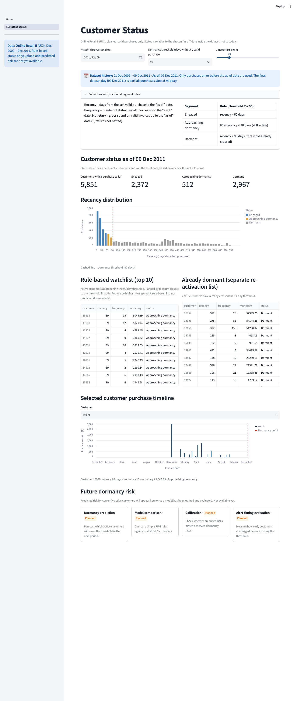

# Non-contractual Customer Dormancy Prediction

Final project for **AAI 627: Big Data Analytics for Engineering Design**,
part of the **M.S. in Data Science** at **Stevens Institute of Technology**.

A Streamlit website that turns retail purchase history into a current view of each customer:
who is **engaged**, who is **approaching dormancy**, and who is already **dormant**. Its goal is
to help a retention team decide whom to contact when it can reach only a limited number of
customers.

> **Current stage: fixed-window modeling iteration, after the November 26 milestone (alert timing, model
> sensitivity, compatible datasets).** The new model comparison is offline only; the website is unchanged by it.
>
> - **On the website:** rule-based customer status and watchlist, descriptive
>   [RFM lifecycle segments](#rfm-lifecycle-segments), an [upload workflow](#using-your-own-data) for
>   descriptive analysis of your own transactions, and two clearly labeled analysis pages:
>   [Alert timing](#alert-timing) (an offline report, shown as generated) and
>   [Model sensitivity](#model-sensitivity) (interactive, hypothetical input values only).
> - **Not on the website:** predicted risk for any customer. The dormancy-risk models are exploratory and
>   **not validated** (see [Offline modeling](#offline-modeling)), and they are never applied to uploaded data.
> - See [Project status](#project-status) for what works where.
>
> **Live site:** https://gabriel-reynoso-customer-churn.streamlit.app (shows the last deployed milestone).

---

## Contents

1. [The problem](#the-problem)
2. [Key definitions](#key-definitions)
3. [Dataset](#dataset)
4. [Quick start](#quick-start)
5. [Website tour](#website-tour)
6. [RFM lifecycle segments](#rfm-lifecycle-segments)
7. [Using your own data](#using-your-own-data)
8. [Alert timing](#alert-timing)
9. [Model sensitivity](#model-sensitivity)
10. [Offline modeling](#offline-modeling)
11. [Project status](#project-status)
12. [Repository structure](#repository-structure)

---

## The problem

In **non-contractual** retail, customers never formally cancel; they simply stop buying. The
business has no explicit "churn" event, so it has to infer engagement from purchase behavior.

**Business question:** *Which customers appear engaged, which are approaching dormancy, and which
are already dormant?*

**Who would use it:** retention, CRM, and marketing teams at a retailer.

**Why ranking matters:** outreach is limited. A team may only be able to email, call, or send
offers to **N** customers per cycle, so the site has to **rank** customers, not just label them.

- Customers who are **still active but approaching the threshold** are the main outreach
  candidates.
- Customers who are **already dormant** are listed separately, because winning them back is a
  different task.

---

## Key definitions

| Term | Meaning |
|---|---|
| **Valid purchase** | A non-cancelled invoice with an identified customer, positive quantities and prices, and at least one product line (see [Cleaning rules](#cleaning-rules)) |
| **Observation ("as of") date** | The date the analysis is run from. Only transactions on or before it are used |
| **Recency** | Days from the last valid purchase to the as-of date |
| **Frequency** | Number of distinct valid invoices up to the as-of date |
| **Monetary** | Gross spend (£) on valid invoices up to the as-of date; returns are not netted |
| **Dormant** | Recency of at least **90 days** (provisional threshold; 60 and 120 days will also be compared) |

**Dormancy is a state, not an exit.** A dormant customer may purchase again.

### Provisional segments (threshold T, default 90 days)

| Segment | Rule |
|---|---|
| Engaged | recency < T − 30 |
| Approaching dormancy | T − 30 ≤ recency < T (still active) |
| Dormant | recency ≥ T (threshold already crossed) |

**Current status vs. future risk:** *status* describes where a customer stands today, based on
recency. *Dormancy risk* would be a forecast of who becomes dormant next. Only status is shown
today. Risk is a planned feature.

---

## Dataset

**Online Retail II**, from the [UCI Machine Learning Repository](https://archive.ics.uci.edu/dataset/502/online+retail+ii).
It contains transactions from a UK-based online retailer.

Credit: Chen, D. (2012). *Online Retail II* [Dataset]. UCI Machine Learning Repository.
https://doi.org/10.24432/C5CG6D. Licensed under CC BY 4.0.

Verified by this project:

- Two sheets, `Year 2009-2010` and `Year 2010-2011`, with **1,067,371** rows in total
- Purchases from **1 Dec 2009 to 9 Dec 2011**. The last day is partial: purchases stop at 12:50
- Columns: `Invoice`, `StockCode`, `Description`, `Quantity`, `InvoiceDate`, `Price`,
  `Customer ID`, `Country`

The raw workbook is **not** committed. Download it to `data/online_retail_II.xlsx` (gitignored) and
run `python prepare_data.py` (needs `pip install openpyxl`) to rebuild the files in `processed/`.
The website reads only `processed/invoices.csv.gz`.

### Cleaning rules

Full counts are in [`processed/data_quality.md`](processed/data_quality.md).

| Rule | Rows removed |
|---|---:|
| Sheet 1 repeats 1–9 Dec 2010, which sheet 2 also holds; keep the sheet-2 copy (verified identical) | 22,523 |
| Missing `Customer ID` | 235,287 |
| Cancellation invoices (`C` prefix), stored separately in `processed/cancellations.csv.gz` | 18,446 |
| Quantity ≤ 0 or price ≤ 0 | 70 |
| `TEST*` and `ADJUST*` lines | 45 |
| Invoices with only postage, carriage, manual, bank-charge or discount lines | 350 |
| Purchases fully cancelled on the **same calendar day** (98 invoices, 77 customers) | 809 |

What remains is **36,496 invoices from 5,851 customers**, with a gross amount of **£16,945,042.16**.

- **Same-day full cancellations are removed.** A purchase is removed only when all of its lines
  (StockCode, quantity, price) are matched by cancellation lines from the same customer, on the
  same calendar day, issued at or after the purchase. This includes invoice 581483 (£168,469.60,
  customer 16446) and invoice 541431 (£77,183.60, customer 12346).
  - Because as-of dates are end-of-day, this never uses information that would be unavailable
    on the date being viewed.
  - **Ambiguous days are kept:** on 9 customer-days, each invoice matches on its own but the
    cancellations can't cover all of them together.
  - **Non-line-for-line cancellations are kept:** for example, invoice 556444 (£38,970) was
    reversed by a single manual `M` line, so it stays in the data.
- **Later cancellations are never applied.** A purchase cancelled on a later day stays in, so
  earlier as-of views are not affected by what happened afterwards.
- **Identical lines within a sheet are kept (11,602 rows).** They cannot be told apart from
  genuine repeat lines. Removing them would lower the gross total by £56,306.31.
- **Rounding:** each invoice amount is rounded to the penny once, and every total is the sum of
  those rounded amounts.

---

## Quick start

**Requirements:** Python 3.10 or newer.

```bash
# 1. Create and activate a virtual environment (first time only)
python3 -m venv .venv
source .venv/bin/activate        # Windows: .venv\Scripts\activate

# 2. Install dependencies (first time only)
pip install -r requirements.txt

# 3. Run the website
streamlit run app.py
```

Then open **http://localhost:8501**. Press `Ctrl+C` in the terminal to stop the server.

---

## Website tour

Current screenshots are in [`artifacts/submission5/`](artifacts/submission5/).

### 1. Main page (sidebar: "Home")

- **Headline and introduction:** "Protect Your Customer Lifecycle".
- **Upload transaction data:** opens the Data page, where a CSV is checked before it is used.
- **Open customer status:** opens the results page.
- **Explore continuous monitoring:** informational only, **not implemented**.
- **What you'll see:** a preview of the features. Dormancy-risk models are marked **Offline analysis**.

### 2. Customer status

Built from the Online Retail II data. The dataset's date range and the selected as-of date are
shown at the top, so the "current" status always means status on that date within the
dataset, not today.

| Control | Effect |
|---|---|
| As-of date | Uses only purchases on or before this date, then recalculates everything. Shared with the Customer segments page |
| Dormancy threshold (60 / 90 / 120 days) | Moves the segment boundaries and the earliest as-of date you can choose. Shared with the Customer segments page |
| Contact-list size N | Sets how many customers appear in the watchlist |
| Customer | Shows that customer's invoices up to the as-of date |

What the page shows:

- **Status counts:** engaged, approaching dormancy, dormant.
- **Recency distribution** with the threshold marked.
- **Rule-based watchlist:** the top N *active* customers approaching dormancy.
  - Ranked by recency, with customers closest to the threshold first.
  - Ties are broken by higher gross spend.
  - This is **not** predicted dormancy risk.
- **Already dormant:** a separate re-activation list.
- **Purchase timeline** for a selected customer: observed invoices up to the as-of date only. Below the
  chart, *Dormancy date if there is no further purchase* = the latest purchase on or before the as-of
  date plus the selected threshold. It is a calendar rule, not a model prediction. If that date has
  already passed, it is marked on the chart and described as reached.
- **Future dormancy risk:** a note that no customer is scored, pointing to the Alert timing and Model
  sensitivity pages.




The earlier mock-data version is in [`artifacts/submission4/`](artifacts/submission4/).

### 3. Customer segments

Descriptive RFM lifecycle segments for customers who are **active** on the chosen observation date
(definitions in the [next section](#rfm-lifecycle-segments)). The screenshots above predate this page.

- **Shared controls:** the observation date and dormancy threshold are the same settings as on the
  Customer status page. Changing either on one page carries over to the other.
- **Dates before 30 Dec 2010:** the status page accepts them, but the segments page shows an explanation
  instead of segments, because the cutoffs are learned from December 2010. The shared date is left as
  chosen.
- **Header:** the observation date, dormancy threshold, reference dates and the three cutoffs, with notes
  on seasonality and shorter histories.
- **Customers by segment:** a count per segment, and a summary table with the number of recently acquired
  customers and the median recency, invoices, spend and observed tenure of each segment.
- **Recency versus frequency:** one point per active customer. The dashed cutoff lines split the chart
  into high/low R and F, and two colors show high versus low spend, so position and color together give
  the segment. Hover shows the customer, segment, recently acquired flag and values.
- **Inspect a segment:** pick a segment, click a customer row, and see the same purchase timeline and
  conditional dormancy date as on the status page.
- Segments are **not** dormancy probabilities, and say nothing about the effect of contacting a customer.

### 4. Alert timing

Shows [`processed/alert_timing.md`](processed/alert_timing.md) exactly as generated offline, under a notice
that it is a retrospective analysis of Online Retail II and says nothing about the effect of an alert. It
does not use the shared date or threshold. See [Alert timing](#alert-timing).

### 5. Model sensitivity

Interactive. Pick a forecast horizon, enter two hypothetical customer profiles, and see what the model's
equation returns for each, plus one-input-at-a-time charts. No real customer is scored. See
[Model sensitivity](#model-sensitivity).

### 6. Data

Shows the dataset in use, and lets you upload, map, check and switch to your own CSV, or switch back to
Online Retail II. See [Using your own data](#using-your-own-data).

The shared observation date and dormancy threshold are kept while you visit these three pages.

---

## RFM lifecycle segments

Code: [`segments.py`](segments.py). Offline summary: [`processed/segment_evaluation.md`](processed/segment_evaluation.md).

The idea of eight high/low R-F-M combinations is the widely used RFM segmentation scheme. This project
borrows only that idea: the cutoffs, the names, the recently acquired flag and the trailing window below
are this project's own choices, and no published methodology is reproduced.

### Measures (purchases on or before the end of the observation date only)

| Measure | Definition |
|---|---|
| Recency | Days from the last valid purchase to the observation date (whole history, as on the status page) |
| Frequency | Distinct valid invoices in the **trailing 365 days** |
| Monetary | Gross spend (£) on those invoices; returns not netted, same cleaning rules |
| Observed tenure | Days from the first **observed** purchase to the observation date |

**Why a 365-day window and not the whole history.** The model evaluation found that cumulative frequency
and spend grow with the amount of history observed. Among the reference-type customers the median
cumulative invoice count rises from 5 (Dec 2010) to 8 (Sep 2011), while the 365-day count stays at 5. A
fixed cutoff on cumulative values would label more customers "high" just because more history is visible.
The status page still shows whole-history frequency and spend, so the two pages can show different values
for a customer.

**Shorter available history.** A customer first seen fewer than 365 days ago is compared on less than a
year of invoices and is more likely to be low F / low M. That includes every recently acquired customer.
The data start on 1 Dec 2009, so a first observed purchase may not be a customer's true first purchase.

### Cutoffs

- **Reference customers:** customers who are active (under the selected dormancy threshold) and were
  first observed at least 90 days earlier, pooled over five weekly dates: **2, 9, 16, 23 and 30 Dec
  2010**. These are the first dates with a complete 365-day window, and all fall inside the offline
  training period. The 90-day tenure rule keeps December's many first-time buyers from pulling the
  frequency and spend medians down. It is separate from the 30-day recently acquired flag.
- **Cutoff = the median** of each measure among those rows. For the 90-day threshold (9,626 rows):
  recency **29 days**, frequency **5 invoices**, monetary **£1,522.27**. (60 days: 22 / 5 / £1,671.14;
  120 days: 35 / 4 / £1,363.54.)
- **High/low:** high R = recency ≤ cutoff (**high R means a more recent purchase**); high F and high M =
  value ≥ cutoff. **A value equal to a cutoff is high.** Because frequency is a whole number, more than
  half of the reference customers are high F.
- The cutoffs are fixed numbers for every later date. They are never recomputed from the observation
  date's data, from later purchases, or from outcomes.
- **December seasonality.** The reference dates cover heavy pre-Christmas buying and a quiet last week.
  The recency cutoff reflects that mix, so the share of high-R customers changes through the year.
- **No segments** when the observation date is before 30 Dec 2010, or when fewer than 100 reference rows
  exist. If a combination has no customers on a date, it is listed with a count of zero.

### Segments

Every **active** customer gets exactly one of the eight segments. Dormancy status is separate: dormant
customers keep their status on the status page and have no segment. A segment describes one date; it is
not a prediction and not a permanent label.

| Segment | R | F | M |
|---|---|---|---|
| Core customers | High | High | High |
| Frequent, lower spend | High | High | Low |
| Infrequent, high spend | High | Low | High |
| Recent light buyers | High | Low | Low |
| Core, less recent | Low | High | High |
| Frequent lower spend, less recent | Low | High | Low |
| Infrequent high spend, less recent | Low | Low | High |
| Low activity | Low | Low | Low |

### Recently acquired flag

A separate yes/no flag shown next to the segment. It never replaces or changes the RFM segment.

- **Flagged when** the first observed purchase was **less than 30 days** before the observation date, and
  the data cover at least 270 days before that purchase (always true from 30 Dec 2010 on).
- **The first observed purchase may not be the customer's true first purchase.** The data start on
  1 Dec 2009, so a flagged customer may be a returning one who last bought before then.
- On 9 Dec 2011, 152 of 2,884 active customers carry the flag.

### Later observed dormancy by segment (offline, descriptive)

`python segments.py` writes [`processed/segment_evaluation.md`](processed/segment_evaluation.md). It is not
shown on the website, because later outcomes are not known on the observation date.

- **Scoring dates:** 31 Mar, 30 Jun and 8 Sep 2011. **Outcome:** first reaching 90 days without a valid
  purchase within the next 90 days. Every scoring date + 90 days is on or before 8 Dec 2011 (the last
  complete day), so all 5,626 customer-dates have a complete outcome and none is excluded. Later dates
  would have incomplete follow-up and are left out.
- Pooled rates by segment: Core customers 15.7% (n = 1,348), Frequent, lower spend 41.1% (236), Core,
  less recent 47.5% (788), Infrequent, high spend 48.3% (174), Recent light buyers 60.6% (1,096),
  Frequent lower spend, less recent 63.6% (228), Infrequent high spend, less recent 68.2% (236), Low
  activity 82.8% (1,520); all active 53.2%.
- Recently acquired flag, reported separately: flagged 57.1% (n = 382), not flagged 52.9% (5,244).
  Flagged customers are also counted in their segment.
- These are group frequencies in periods already inspected during model evaluation. They are not
  individual probabilities, and they do not show what contacting a customer would change.

### Limitations

- **Seasonal reference.** All reference dates are in December 2010. Recency is seasonal, so the share of
  high-R customers changes through the year.
- **Shift is reduced, not removed.** On 9 Dec 2011 the 365-day medians are lower (4 invoices, £1,248)
  than the reference, mainly from customer mix and season.
- **Historical coverage.** Tenure is left-truncated at 1 Dec 2009; some customers flagged recently
  acquired may be returning ones. Customers with less than a year of observed history lean low F / low M.
- **Small segments.** Frequency and spend move together, so the mixed groups are small (55–145 customers
  on the dates checked). Their medians and rates are unstable.
- **Carried over:** purchases cancelled on a later day still count, and amounts are gross.

---

## Using your own data

**Data** page → upload a CSV → map the columns → **Check this file** → **Use this dataset**.
The page offers two downloads: **Download minimum CSV template** (the four columns `customer`, `invoice`,
`date`, `amount`; one row per invoice; synthetic; passes every check and has enough history for segments)
and a separate sample file with extra columns and invalid rows for trying the quality checks. Upload
guidelines sit next to the buttons. The status and
segments pages then run on your file until you switch back or close the page. Online Retail II is always
available. Code: [`upload.py`](upload.py), [`data_page.py`](data_page.py).

### Canonical invoice table

Every page works from one table with one row per valid purchase invoice, the format of
`processed/invoices.csv.gz`:

| Column | Meaning |
|---|---|
| `customer` | Customer identifier, kept as text |
| `invoice` | Invoice / transaction identifier, unique |
| `date` | Earliest timestamp of the invoice |
| `amount` | Gross amount of the invoice |

### What you provide

- **A CSV** up to 100 MB; comma, semicolon, tab or pipe separated; UTF-8 or Latin-1. Excel files are not
  read (that would add a dependency); export to CSV first.
- **Four mapped columns:** customer identifier, invoice identifier, date, purchase amount. Optionally a
  **quantity** column, in which case amount = quantity × the mapped (unit price) column. The page guesses
  the mapping from the column names and you can change it.
- **What a row is:**
  - *One row per invoice line* (default when identifiers repeat): rows with the same invoice identifier
    are added up into one invoice, with the earliest date. Identical rows are kept and counted, because
    two products can look the same on the mapped columns.
  - *One row per invoice:* a repeated identifier is a duplicate. Exact copies are dropped; identifiers
    repeated with different values are excluded as a whole.
- **Date order** is detected automatically (day first or month first) and can be forced. A column must use
  one date format throughout. Amounts must use a decimal point.

### Checks

Rows are excluded and counted when: the customer or invoice identifier is missing; the date is missing,
unreadable or after today; the amount is missing or not a number; the amount is zero or negative (returns,
cancellations and free items are dropped, never netted, as for the bundled data). Invoices that list more
than one customer are excluded.

The file **cannot be used** when:

- a required column is not mapped, is mapped twice, or is missing;
- no valid rows remain, or more than 50% of the rows are excluded (usually a wrong mapping);
- the purchases span fewer than 120 days (the largest dormancy threshold);
- only one customer is found.

The quality summary shows rows read, used and excluded by reason, invoices, customers, the date range, the
total amount, rows per invoice, identical rows, the share of repeat customers and the first date on which
segments are available.

### Segments for uploaded data

- Cutoffs are **never** the Online Retail II values. They are computed with the same rule from the
  uploaded file: five weekly dates starting 366 days after its first purchase (for Online Retail II this
  rule gives 2 – 30 Dec 2010).
- Segments therefore need **394 days** of history and at least 100 reference customer rows. With less, the
  status page works and the segments page explains why it cannot.
- The single-month reference period can be unrepresentative of the year, as for the bundled data.

### Limits

- **No predictions for uploaded data.** The models were trained on one retailer and are not validated even
  there. Another dataset needs its own training, or a transfer validation, first.
- **Generic cleaning only.** The Online Retail II-specific rules (sheet overlap, same-day full
  cancellations, test codes, postage-only invoices) are not applied. Uploading the raw UCI file as CSV
  gives 36,969 invoices and 5,878 customers, against 36,496 and 5,851 in the bundled table.
- **Session only.** The file is held in the app's memory for the browser session. It is not written to
  disk, stored, or sent to another service, and it is gone after a reload. On the hosted site that memory
  is on the hosting provider's server.
- **Size and speed.** Tested locally with the raw UCI file (95 MB, 1.07 million rows): the check took about
  4 seconds and the status and segments pages then loaded in about a second. The server process grew to
  about 670 MB. Upload time on the hosted site depends on the connection and was not measured. A free
  hosted app has limited memory shared by all visitors, so files near the 100 MB limit, or several large
  uploads at once, may restart it. `maxUploadSize` in `.streamlit/config.toml` can be lowered.
- Thresholds stay 60 / 90 / 120 days. A currency symbol is optional and only changes labels.

---

## Alert timing

Report: [`processed/alert_timing.md`](processed/alert_timing.md), from `python alert_timing.py`. Offline,
exploratory, Online Retail II only, 90-day threshold.

- **Question:** what was knowable 60, 30 and 7 days before a dormancy event that was **later observed**?
- **Matching:** scoring is weekly, so the alert date is the latest scoring date at least L days before the
  event. The actual lead is L to L + 6 days and is reported. The row used is the customer's ordinary
  snapshot on that date; the event date only decides which row to look at.
- **Retrospective:** on the alert date nobody knew which customers these were. The report therefore also
  gives the forward-looking counterpart: all customers in the same recency band on that date, and how many
  became dormant.
- **Populations and denominators:**
  - Event-aligned tables: observed events with an alert date after 31 Dec 2010 (3,051 / 3,933 / 4,415 at
    60 / 30 / 7 days), so the model coefficients were fitted on earlier data.
  - Top-N: lists are ranked among all customers active that week; capture = captured events ÷ matched
    events.
  - Band tables: customer-dates in the band whose pending dormancy day is on or before 8 Dec 2011.
- **Incomplete follow-up:** unobserved events cannot be aligned; band rows whose pending day is after
  8 Dec 2011 are excluded and counted (2,245 / 735 / 176).
- **Repeats and overlap:** each event counts once per lead, and a customer can have several events. Within
  a table no row repeats, but rows are not independent and no intervals are given.
- **Main findings:**
  - Recency on the alert date is fixed by the lead (90 − lead). The website rule is silent 60 days ahead,
    flags 13% of events 30 days ahead and all of them 7 days ahead.
  - Top-200 lists capture 72% (website rule) and 64% (rfm model) of events 7 days ahead. At 60 days both
    capture less than a random list, because the lists fill with customers nearer the threshold.
  - Of customers 60–66 days from the threshold, 47% became dormant; at 30–36 days, 75%; at 7–13 days, 93%.
    The recency model's mean risk is close to these rates; the rfm model's is lower.
- **Not shown:** that an alert or contact keeps a customer active. That needs a randomized or otherwise
  causal design.
- **Needed before model-based alerts go on the website:** window-stable features, a model frozen before a
  later (prospective) evaluation, calibration checked there, and a chosen alert threshold or list size.

---

## Model sensitivity

Page: **Model sensitivity**. Report: [`processed/model_sensitivity.md`](processed/model_sensitivity.md).
Code: [`sensitivity.py`](sensitivity.py).

- **What it is:** how one model's output changes when its input values change. It is **not** a prediction
  of what happens if a customer is contacted or changes behaviour.
- **Model:** `rfm+platt` from the Nov 19 evaluation: logistic regression on recency, tenure, invoice
  count and gross spend, then Platt recalibration. **Threshold:** 90 days. **Horizons:** 30, 60 and 90
  days (90 is exploratory).
- **Inputs** are the weekly-snapshot features, cumulative since the first observed purchase. They are not
  the trailing 365-day values of the segments page.
- **Eligibility:** at horizon h a recency below 90 − h cannot reach 90 days in time, so the output is
  exactly 0, then jumps at the boundary. The page and report show this rather than smoothing it.
- **Realistic profiles only:** recency 0–89; tenure ≥ recency; a single invoice requires tenure = recency;
  spend > 0. Impossible profiles are rejected, and values outside the 1st–99th percentile of the training
  customers are flagged as extrapolation.
- **How the app gets the model:** `python sensitivity.py` writes
  [`processed/sensitivity_model.json`](processed/sensitivity_model.json) (coefficients, scaling,
  calibrator, training ranges; plain numbers, 4 KB). It asserts that these reproduce the evaluation
  pipeline's predictions on all 195,217 snapshot rows. The page reads only that file.
- **Limitations:** the test period had already been inspected and six candidates were compared on it; no
  later independent holdout exists; cumulative inputs drift; the level is off in the test period
  (60-day horizon: 0.745 predicted vs 0.700 observed); inputs do not move independently in real customers.
- No customer on the website is scored, and the page says so.

---

## Offline modeling

Dormancy-risk models and their evaluation. They run **offline**. The website reads two of their outputs:
the alert-timing report and the sensitivity coefficients. It still ranks customers with the rule-based
watchlist and scores no customer.

```bash
python build_snapshots.py    # weekly snapshots + 30/60/90-day labels -> data/weekly_snapshots.csv.gz
python train_baselines.py    # Nov 12 baselines -> processed/baseline_results.md, data/models/baselines.json
python evaluate_models.py    # Nov 19 evaluation -> processed/model_evaluation.md, processed/reliability_eligible.png
python segments.py           # segment counts and later dormancy -> processed/segment_evaluation.md
python alert_timing.py       # Nov 26 alert timing -> processed/alert_timing.md
python sensitivity.py        # Nov 26 sensitivity -> processed/sensitivity_model.json, processed/model_sensitivity.md
python fixed_window.py       # fixed-window features and model comparison -> processed/fixed_window_evaluation.md
python test_snapshots.py && python test_baselines.py && python test_evaluation.py && python test_segments.py \
  && python test_alerts.py && python test_sensitivity.py && python test_upload.py \
  && python test_fixed_window.py   # checks
```

The modeling scripts need pandas and numpy; `evaluate_models.py` also needs matplotlib
(`pip install matplotlib`), and so do `alert_timing.py` and `sensitivity.py`, which reuse its model fitting.
`test_segments.py`, `test_sensitivity.py` and `test_upload.py` also run the pages and need streamlit. These are not in `requirements.txt`, which lists only what the website needs.
`evaluate_models.py` takes about 15 seconds. It also re-checks the snapshot pipeline on real data (an
independent recomputation of 1,000 rows, and a truncation test for future data).

- **Snapshots:** every Thursday from 4 Mar 2010 to 8 Dec 2011 (the last complete day), each customer who
  is still active under the 90-day threshold. Features use only purchases up to the end of that day:
  recency, tenure, frequency, and gross spend.
- **Label:** the customer first reaches 90 days without a valid purchase within the next 30, 60 or 90
  days. Outcomes that run past 8 Dec 2011 are **censored** and excluded, not counted as negative.
  Method and audit: [`processed/snapshot_audit.md`](processed/snapshot_audit.md).
- **Calendar split** (no random rows): train labels end by 31 Dec 2010, validation by 30 Jun 2011,
  and test by 8 Dec 2011. Each label is fully observed before the next period starts.
- **Nov 12 baselines:** a constant event rate, a recency-only logistic regression, and a recency +
  tenure + frequency + monetary logistic regression. Recency was chosen on validation Brier score.
  Results: [`processed/baseline_results.md`](processed/baseline_results.md).
- **Nov 19 evaluation:** [`processed/model_evaluation.md`](processed/model_evaluation.md).
  - **Populations:** each model is scored on all active customers and on customers *eligible* to cross the
    threshold within the horizon (recency ≥ 90 − h).
  - **Calibration:** reliability tables and a plot, plus calibration slopes.
  - **Targeting:** weekly top-N (N = 50/100/200), compared with random selection and the website's own
    recency rule.
  - **Model study:** recalibration (Platt) and refitting on eligible customers. Fitting uses train,
    calibration uses validation, and comparison uses test.
  - **Main findings:**
    - Overall metrics mostly reflect eligibility.
    - The Nov 12 models are miscalibrated for eligible customers.
    - Refitting on eligible customers or recalibrating improves probabilities.
    - RFM's frequency, spend and tenure features are cumulative and drift over time.
    - No model beats the website's recency ordering for short contact lists by more than about 2 points.
- **The test period is not an untouched holdout.** It was first inspected on Nov 12, so every test result
  from Nov 19 is **exploratory**. The data end in December 2011, so no later holdout exists. Confirming a
  model needs a prospective (shadow) evaluation. The 90-day horizon is also exploratory.
- **Top-N capture measures predictive targeting, not the effect of contacting customers.**
- Generated tables, predictions and model files live in `data/`, which is gitignored.

### Fixed-window features and model comparison

Report: [`processed/fixed_window_evaluation.md`](processed/fixed_window_evaluation.md), from
`python fixed_window.py` (about 25 seconds; it rebuilds the snapshots in memory from `processed/` and needs
matplotlib through `evaluate_models.py`). The cumulative-feature pipeline and its reports are untouched,
and the old models are refitted by the old code as comparators. Nothing here is used by the website.

- **Features on each weekly scoring date:** recency; invoices and gross spend in the last 365 or 180
  days; purchase days in the window; cancellation count and net spend in the window; tenure capped at
  the window length. Only invoices and cancellations dated on or before the scoring date are used, and
  the population is unchanged.
- **Main concern found:** no training scoring date has a full 365-day window, because the data start a
  year before training ends. In training the 365-day features equal the cumulative ones, so `fw365` has
  the same coefficients as the old `rfm-elig` and only its later inputs differ. A 180-day window is
  complete from 29 May 2010, so the `fw180` models are fitted on those dates only.
- **Candidates:** `fw365`, `fw180`, `fw180-days` (purchase days instead of invoices), `fw180-net` (net
  spend and cancellation count). Baselines: constant, eligible-group constant, `recency-elig`, the old
  `rfm-elig`, and the website rule as a ranker. All models are fitted on eligible training rows and
  return 0 for customers who cannot reach 90 days within the horizon. No recalibration.
- **Roles:** fit on train, compare and select on validation, test reported afterwards as exploratory.
  Censored labels are dropped. **Neither later period is a fresh holdout:** both were examined in
  earlier milestones.
- **Selection rule, written before the first run:** a candidate must beat `recency-elig` on eligible
  validation Brier score with a customer-bootstrap 95% interval excluding zero, and stay within 1 point of
  the website rule's top-100 capture. Otherwise `recency-elig` stays.
- **Result (validation, eligible customers):**

  | Horizon | Selected | Brier: `recency-elig` → best fixed-window | AUC: `recency-elig` → fixed-window | Top-100 capture: rule → model |
  |---|---|---|---|---|
  | 30 days | `recency-elig` (no candidate qualifies) | 0.0846 → 0.0834 (interval spans zero) | 0.69 → 0.75–0.77 | 21.5% → 21.7% |
  | 60 days | `fw180-days` | 0.1537 → 0.1448 | 0.75 → 0.80–0.81 | 11.0% → 11.0% |
  | 90 days (exploratory) | `fw180-days` | 0.1824 → 0.1602 | 0.78 → 0.85 | 7.7% → 7.8% |

- **Reading:**
  - Fixed windows improve probabilities at 60 and 90 days, not at 30.
  - They do not improve ranking beyond what the old cumulative model already had.
  - They do not improve short contact lists: the rule-based watchlist is as good.
  - Every model under-predicts on validation (60 days: 0.68 predicted vs 0.78 observed), partly because
    training has no winter dates.
  - Purchase days and net spend make no measurable difference; the three 180-day models are one candidate.
  - Exploratory only: when all models are refitted through June 2011, `fw365` overtakes `fw180`. The
    180-day advantage comes from the short training history, not from the window itself.
- **Recommendation:** the 180-day model at the 60-day horizon is ready for *additional evaluation*, not for
  use. The report's Section 9 gives the confirmation plan (freeze, score forward, wait for outcomes, evaluate
  once, at least a year) and what an external dataset would have to offer; none was checked. Section 10
  separates this course demonstration from evidence sufficient for production.

---

## Project status

| Area | Status |
|---|---|
| Problem definition and dormancy rule | ✅ Defined (threshold is provisional) |
| Data audit and cleaning of Online Retail II | ✅ Done (`prepare_data.py`, `processed/data_quality.md`) |
| RFM status, segment counts, timelines on real data | ✅ Works |
| Rule-based top-N watchlist | ✅ Works. A rule, not a prediction |
| Upload of compatible transaction data (CSV, column mapping, validation, own segment cutoffs) | ✅ On the website (`data_page.py`). Descriptive analysis only, session only |
| Time-aware use of cancellations and returns | ⏳ Planned |
| Weekly snapshots, censoring-aware labels, calendar split | ✅ Done, offline (`build_snapshots.py`) |
| Initial logistic-regression baselines (AUC, Brier) | ✅ Done, offline (`train_baselines.py`). Not shown on the site |
| Calibration, eligible-group and top-N evaluation; recalibration study | ✅ Done, offline (`evaluate_models.py`). Test results exploratory |
| RFM lifecycle segments: eight groups plus a recently acquired flag (trailing 365-day window, fixed Dec 2010 cutoffs) | ✅ On the website (`segments_page.py`). Descriptive, not a prediction |
| Shared observation date and threshold across pages; conditional dormancy date on the timeline | ✅ Works |
| Later dormancy by segment | ✅ Done, offline (`processed/segment_evaluation.md`) |
| Fixed-window features and pre-specified model comparison | ✅ Done, offline (`fixed_window.py`). Exploratory: no fresh holdout |
| Prospective (frozen-model) or external confirmation | ⏳ Not possible within this dataset; plan in `processed/fixed_window_evaluation.md` |
| Alert-timing analysis (60 / 30 / 7 days before observed dormancy) | ✅ Done, offline (`alert_timing.py`); report shown on the website. Retrospective, exploratory |
| Model sensitivity | ✅ On the website for hypothetical inputs (`sensitivity_page.py`), plus an offline report. Model not validated |
| Model-based alerts and per-customer predictions on the website | ⛔ Blocked: needs a frozen model confirmed on later or external data. The site still shows the rule-based watchlist |
| Predictions for uploaded data | ⛔ Not available: needs model training or transfer validation on that data |
| Chatbot | ⏳ Scheduled for December 3 |
| Deployment to Streamlit Community Cloud | ✅ Live at https://gabriel-reynoso-customer-churn.streamlit.app (rule-based watchlist only) |
| Continuous monitoring integration | ❌ Out of scope for the course |

All model fitting and evaluation is offline. The website shows model output only on the Model sensitivity
page, for hypothetical inputs, and offline evaluation tables only on the Alert timing page. It shows no
predicted risk for any customer and no outreach-effect values.

---

## Repository structure

```
.
├── app.py                  # Entry point: page navigation and sidebar notice
├── main_page.py            # Landing page
├── results_page.py         # Customer status dashboard (status, watchlist, timeline)
├── segments_page.py        # Customer segments page (RFM lifecycle segments)
├── data_page.py            # Data page: dataset in use, CSV upload, column mapping, checks
├── alerts_page.py          # Alert timing page: shows processed/alert_timing.md
├── sensitivity_page.py     # Model sensitivity page (hypothetical inputs only)
├── upload.py               # Uploaded table -> canonical invoice table, validation, template and sample files
├── sensitivity.py          # Model equation from the stored coefficients; run it to rebuild them and the report
├── alert_timing.py         # Offline: lead-time matching, event-aligned and band tables
├── fixed_window.py         # Offline: fixed-window features, pre-specified model comparison, confirmation plan
├── segments.py             # RFM table, reference cutoffs, segment mapping, flag; run it for the offline summary
├── shared.py               # Dataset in use, shared date/threshold controls and purchase timeline
├── prepare_data.py         # Rebuilds processed/ from the raw UCI workbook
├── build_snapshots.py      # Offline: weekly snapshots and 30/60/90-day dormancy labels
├── train_baselines.py      # Offline: split comparison and logistic-regression baselines
├── evaluate_models.py      # Offline: calibration, eligible-group and top-N evaluation, recalibration study
├── test_snapshots.py       # Checks for labels, resets, censoring
├── test_baselines.py       # Checks for predictor allowlist and split boundaries
├── test_evaluation.py      # Checks for eligibility, role boundaries, calibration separation, top-N
├── test_segments.py        # Checks for date boundaries, RFM values, cutoff ties, mapping, flag, timeline date,
│                           #   shared controls, insufficient data (the page checks need streamlit)
├── test_alerts.py          # Checks for lead matching, information boundaries, incomplete follow-up, top-N ties
├── test_sensitivity.py     # Checks for the stored model, eligibility boundary, impossible profiles, page labels
├── test_fixed_window.py    # Checks for window edges, cut-off dates, histories, censoring, fit/evaluation separation
├── test_upload.py          # Checks for aggregation, row rules, duplicates, blocking errors, own cutoffs,
│                           #   the minimum template, pages
├── processed/              # invoices.csv.gz (used by the site), cancellations.csv.gz, data_quality.md,
│                           #   snapshot_audit.md, baseline_results.md, model_evaluation.md,
│                           #   reliability_eligible.png, segment_evaluation.md, alert_timing.md,
│                           #   model_sensitivity.md, sensitivity_model.json (read by the site),
│                           #   fixed_window_evaluation.md
├── requirements.txt        # streamlit, pandas, altair, numpy
├── .streamlit/config.toml  # Theme and upload size limit
├── artifacts/submission5/  # Current screenshots of both pages
├── artifacts/submission4/  # Screenshots of the earlier mockup
├── .gitignore              # Ignores data/ (raw workbook, snapshots, models), virtual environments, caches, and secrets
└── README.md
```

---

*Course project for AAI 627 at Stevens Institute of Technology. Dataset source: Online Retail II,
UCI Machine Learning Repository.*
