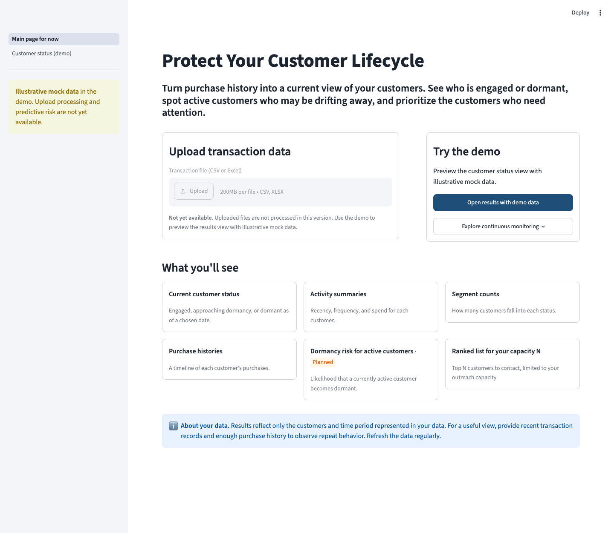
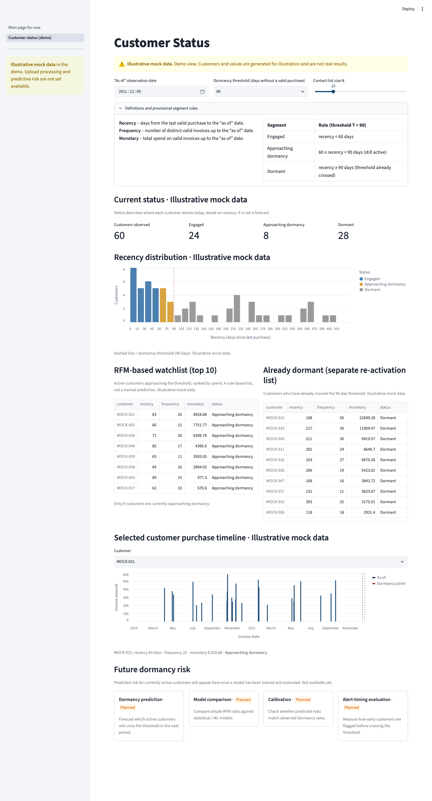

# Non-contractual Customer Dormancy Prediction

Final project for **AAI 627: Big Data Analytics for Engineering Design**,
part of the **M.S. in Data Science** at **Stevens Institute of Technology**.

A Streamlit website that turns retail purchase history into a current view of each customer:
who is **engaged**, who is **approaching dormancy**, and who is already **dormant**. Its goal is
to help a retention team decide whom to contact when it can reach only a limited number of
customers.

> **Current stage: website mockup (Submission 4).** The interface is built and runs locally.
> The results page uses **illustrative mock data**. The audit of the real dataset and the
> predictive modeling are still to come. See [Project status](#project-status).

---

## Contents

1. [The problem](#the-problem)
2. [Key definitions](#key-definitions)
3. [Dataset](#dataset)
4. [Quick start](#quick-start)
5. [Website tour](#website-tour)
6. [Project status](#project-status)
7. [Repository structure](#repository-structure)

---

## The problem

In **non-contractual** retail, customers never formally cancel; they simply stop buying. The
business has no explicit "churn" event, so it has to infer engagement from purchase behavior.

**Business question:** *Which customers appear engaged, which are approaching dormancy, and which
are already dormant?*

**Who would use it:** retention, CRM, and marketing teams at a retailer.

**Why ranking matters:** outreach is limited. A team may only be able to email, call, or send
offers to **N** customers per cycle, so the site has to **rank** customers, not just label them.

- Customers who are **still active but approaching the threshold** are the main outreach
  candidates.
- Customers who are **already dormant** are listed separately, because winning them back is a
  different task.

---

## Key definitions

| Term | Meaning |
|---|---|
| **Valid purchase** | A non-cancelled invoice with an identified customer |
| **Observation ("as of") date** | The date the analysis is run from. Only transactions on or before it are used |
| **Recency** | Days from the last valid purchase to the as-of date |
| **Frequency** | Number of distinct valid invoices up to the as-of date |
| **Monetary** | Total spend on valid invoices up to the as-of date |
| **Dormant** | Recency of at least **90 days** (provisional threshold; 60 and 120 days will also be compared) |

**Dormancy is a state, not an exit.** A dormant customer may purchase again.

### Provisional segments (threshold T, default 90 days)

| Segment | Rule |
|---|---|
| Engaged | recency < T − 30 |
| Approaching dormancy | T − 30 ≤ recency < T (still active) |
| Dormant | recency ≥ T (threshold already crossed) |

**Current status vs. future risk:** *status* describes where a customer stands today, based on
recency. *Dormancy risk* would be a forecast of who becomes dormant next. Only status is shown
today. Risk is a planned feature.

---

## Dataset

**Online Retail II**, from the [UCI Machine Learning Repository](https://archive.ics.uci.edu/dataset/502/online+retail+ii).
It contains transactions from a UK-based online retailer.

As published on the UCI page:

- **1,067,371** records
- **December 2009 to December 2011**
- One **43.5 MB** Excel file
- Fields: `InvoiceNo`, `StockCode`, `Description`, `Quantity`, `InvoiceDate`, `UnitPrice`,
  `CustomerID`, `Country`

> These figures come from UCI and have not yet been re-verified by this project. The data is
> **not** included in this repository. Put downloaded files under `data/`, which is gitignored.

### Known data issues

| Issue | Why it matters | Planned handling |
|---|---|---|
| Missing `CustomerID` | Rows can't be attributed to a customer | Exclude from customer summaries and report how many were dropped |
| Cancelled invoices (`C` prefix, negative quantities) | They are not valid purchases | Exclude from valid purchases and review returns separately |
| Repeated product rows within one invoice | One row is not one purchase | Count frequency as distinct invoices |
| Left-censoring | The first *observed* purchase may not be the customer's true first purchase | Treat tenure as "observed tenure" |

---

## Quick start

**Requirements:** Python 3.10 or newer.

```bash
# 1. Create and activate a virtual environment (first time only)
python3 -m venv .venv
source .venv/bin/activate        # Windows: .venv\Scripts\activate

# 2. Install dependencies (first time only)
pip install -r requirements.txt

# 3. Run the website
streamlit run app.py
```

Then open **http://localhost:8501**. Press `Ctrl+C` in the terminal to stop the server.

---

## Website tour

Screenshots are in [`artifacts/submission4/`](artifacts/submission4/).

### 1. Main page (sidebar: "Main page for now")

The landing page, written as a business product.

- **Headline and introduction:** "Protect Your Customer Lifecycle".
- **Upload transaction data:** shown but **disabled**, and labeled *Not yet available*.
- **Open results with demo data:** opens the results page.
- **Explore continuous monitoring:** opens a short panel describing a possible future
  integration. It is **not implemented** and is outside the course scope.
- **What you'll see:** a preview of the features. Dormancy risk is marked **Planned**.
- **About your data:** a note explaining that results reflect only the data provided.



### 2. Customer status (demo)

An RFM dashboard built on **illustrative mock data**. The label is visible throughout the page.

| Control | Effect |
|---|---|
| As-of date | Drops transactions after the chosen date and recalculates everything |
| Dormancy threshold (60 / 90 / 120 days) | Moves the segment boundaries |
| Contact-list size N | Sets how many customers appear in the watchlist |

What the page shows:

- **Definitions and segment rules**, which update with the threshold.
- **Current status counts:** engaged, approaching dormancy, dormant.
- **Recency distribution** with the threshold marked.
- **RFM-based watchlist:** the top N *active* customers approaching dormancy, ranked by spend.
  This is a rule, **not a trained prediction**.
- **Already dormant:** a separate re-activation list.
- **Purchase timeline** for a selected customer, with the as-of date and dormancy point marked.
- **Future dormancy risk:** prediction, model comparison, calibration, and alert timing, all
  marked **Planned**.



---

## Project status

| Area | Status |
|---|---|
| Problem definition and dormancy rule | ✅ Defined (threshold is provisional) |
| Dataset selection (Online Retail II) | ✅ Selected |
| Website: main page and results layout | ✅ Built and runs locally |
| RFM and segment logic | ✅ Works, **on mock data only** |
| Mock data | ✅ 60 seeded, deterministic customers (`MOCK-###`). Not real findings |
| File upload | ⏳ Shown as disabled. Not functional |
| Data audit and cleaning of Online Retail II | ⏳ Future work |
| RFM on the real data | ⏳ Future work |
| Dormancy risk model and evaluation | ⏳ Planned |
| Continuous monitoring integration | ❌ Out of scope for the course |

**Important:** none of the numbers on the results page are findings from Online Retail II. No
model has been trained, and the site does not report any accuracy, calibration, probability, or
outreach-effect values.

---

## Repository structure

```
.
├── app.py                  # Entry point: page navigation and sidebar notice
├── main_page.py            # Landing page
├── results_page.py         # RFM dashboard (mock data, segments, watchlist, timeline)
├── requirements.txt        # streamlit, pandas, altair
├── .streamlit/config.toml  # Theme
├── artifacts/submission4/  # Screenshots of both pages
├── .gitignore              # Ignores data/, virtual environments, caches, and secrets
└── README.md
```

---

*Course project for AAI 627 at Stevens Institute of Technology. Dataset source: Online Retail II,
UCI Machine Learning Repository.*
