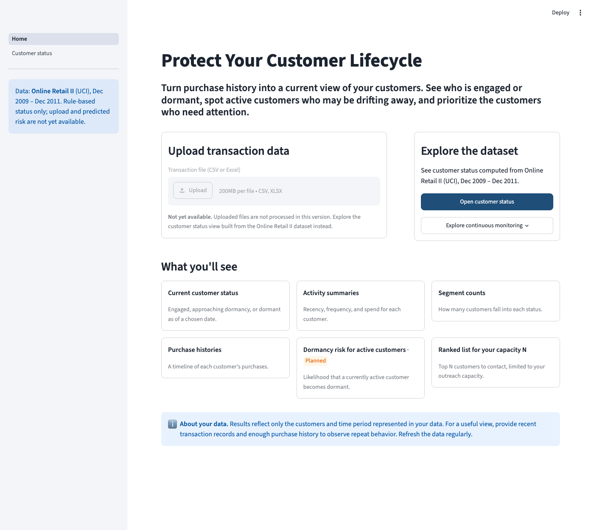

# Non-contractual Customer Dormancy Prediction

Final project for **AAI 627: Big Data Analytics for Engineering Design**,
part of the **M.S. in Data Science** at **Stevens Institute of Technology**.

A Streamlit website that turns retail purchase history into a current view of each customer:
who is **engaged**, who is **approaching dormancy**, and who is already **dormant**. Its goal is
to help a retention team decide whom to contact when it can reach only a limited number of
customers.

> **Current stage: November 19 milestone (offline model evaluation and RFM lifecycle segments).** The
> website runs on the real **Online Retail II** data (cleaned, invoice level). Customer status and the
> watchlist are **rule-based**; the new **Customer segments** page shows descriptive
> [RFM lifecycle segments](#rfm-lifecycle-segments). Dormancy-risk models, their calibration, and top-N targeting are evaluated
> **offline only** (see [Offline modeling](#offline-modeling)); the website does not display model
> predictions or evaluation results. See [Project status](#project-status).
>
> **Live site:** https://gabriel-reynoso-customer-churn.streamlit.app (rule-based status and watchlist; no model predictions;
> the segments page appears once this milestone is deployed).

---

## Contents

1. [The problem](#the-problem)
2. [Key definitions](#key-definitions)
3. [Dataset](#dataset)
4. [Quick start](#quick-start)
5. [Website tour](#website-tour)
6. [RFM lifecycle segments](#rfm-lifecycle-segments)
7. [Offline modeling](#offline-modeling)
8. [Project status](#project-status)
9. [Repository structure](#repository-structure)

---

## The problem

In **non-contractual** retail, customers never formally cancel; they simply stop buying. The
business has no explicit "churn" event, so it has to infer engagement from purchase behavior.

**Business question:** *Which customers appear engaged, which are approaching dormancy, and which
are already dormant?*

**Who would use it:** retention, CRM, and marketing teams at a retailer.

**Why ranking matters:** outreach is limited. A team may only be able to email, call, or send
offers to **N** customers per cycle, so the site has to **rank** customers, not just label them.

- Customers who are **still active but approaching the threshold** are the main outreach
  candidates.
- Customers who are **already dormant** are listed separately, because winning them back is a
  different task.

---

## Key definitions

| Term | Meaning |
|---|---|
| **Valid purchase** | A non-cancelled invoice with an identified customer, positive quantities and prices, and at least one product line (see [Cleaning rules](#cleaning-rules)) |
| **Observation ("as of") date** | The date the analysis is run from. Only transactions on or before it are used |
| **Recency** | Days from the last valid purchase to the as-of date |
| **Frequency** | Number of distinct valid invoices up to the as-of date |
| **Monetary** | Gross spend (£) on valid invoices up to the as-of date; returns are not netted |
| **Dormant** | Recency of at least **90 days** (provisional threshold; 60 and 120 days will also be compared) |

**Dormancy is a state, not an exit.** A dormant customer may purchase again.

### Provisional segments (threshold T, default 90 days)

| Segment | Rule |
|---|---|
| Engaged | recency < T − 30 |
| Approaching dormancy | T − 30 ≤ recency < T (still active) |
| Dormant | recency ≥ T (threshold already crossed) |

**Current status vs. future risk:** *status* describes where a customer stands today, based on
recency. *Dormancy risk* would be a forecast of who becomes dormant next. Only status is shown
today. Risk is a planned feature.

---

## Dataset

**Online Retail II**, from the [UCI Machine Learning Repository](https://archive.ics.uci.edu/dataset/502/online+retail+ii).
It contains transactions from a UK-based online retailer.

Credit: Chen, D. (2012). *Online Retail II* [Dataset]. UCI Machine Learning Repository.
https://doi.org/10.24432/C5CG6D. Licensed under CC BY 4.0.

Verified by this project:

- Two sheets, `Year 2009-2010` and `Year 2010-2011`, with **1,067,371** rows in total
- Purchases from **1 Dec 2009 to 9 Dec 2011**. The last day is partial: purchases stop at 12:50
- Columns: `Invoice`, `StockCode`, `Description`, `Quantity`, `InvoiceDate`, `Price`,
  `Customer ID`, `Country`

The raw workbook is **not** committed. Download it to `data/online_retail_II.xlsx` (gitignored) and
run `python prepare_data.py` (needs `pip install openpyxl`) to rebuild the files in `processed/`.
The website reads only `processed/invoices.csv.gz`.

### Cleaning rules

Full counts are in [`processed/data_quality.md`](processed/data_quality.md).

| Rule | Rows removed |
|---|---:|
| Sheet 1 repeats 1–9 Dec 2010, which sheet 2 also holds; keep the sheet-2 copy (verified identical) | 22,523 |
| Missing `Customer ID` | 235,287 |
| Cancellation invoices (`C` prefix), stored separately in `processed/cancellations.csv.gz` | 18,446 |
| Quantity ≤ 0 or price ≤ 0 | 70 |
| `TEST*` and `ADJUST*` lines | 45 |
| Invoices with only postage, carriage, manual, bank-charge or discount lines | 350 |
| Purchases fully cancelled on the **same calendar day** (98 invoices, 77 customers) | 809 |

What remains is **36,496 invoices from 5,851 customers**, with a gross amount of **£16,945,042.16**.

- **Same-day full cancellations are removed.** A purchase is removed only when all of its lines
  (StockCode, quantity, price) are matched by cancellation lines from the same customer, on the
  same calendar day, issued at or after the purchase. This includes invoice 581483 (£168,469.60,
  customer 16446) and invoice 541431 (£77,183.60, customer 12346).
  - Because as-of dates are end-of-day, this never uses information that would be unavailable
    on the date being viewed.
  - **Ambiguous days are kept:** on 9 customer-days, each invoice matches on its own but the
    cancellations can't cover all of them together.
  - **Non-line-for-line cancellations are kept:** for example, invoice 556444 (£38,970) was
    reversed by a single manual `M` line, so it stays in the data.
- **Later cancellations are never applied.** A purchase cancelled on a later day stays in, so
  earlier as-of views are not affected by what happened afterwards.
- **Identical lines within a sheet are kept (11,602 rows).** They cannot be told apart from
  genuine repeat lines. Removing them would lower the gross total by £56,306.31.
- **Rounding:** each invoice amount is rounded to the penny once, and every total is the sum of
  those rounded amounts.

---

## Quick start

**Requirements:** Python 3.10 or newer.

```bash
# 1. Create and activate a virtual environment (first time only)
python3 -m venv .venv
source .venv/bin/activate        # Windows: .venv\Scripts\activate

# 2. Install dependencies (first time only)
pip install -r requirements.txt

# 3. Run the website
streamlit run app.py
```

Then open **http://localhost:8501**. Press `Ctrl+C` in the terminal to stop the server.

---

## Website tour

Current screenshots are in [`artifacts/submission5/`](artifacts/submission5/).

### 1. Main page (sidebar: "Home")

- **Headline and introduction:** "Protect Your Customer Lifecycle".
- **Upload transaction data:** shown but **disabled**, and labeled *Not yet available*.
- **Open customer status:** opens the results page.
- **Explore continuous monitoring:** informational only, **not implemented**.
- **What you'll see:** a preview of the features. Dormancy risk is marked **Planned**.

### 2. Customer status

Built from the Online Retail II data. The dataset's date range and the selected as-of date are
shown at the top, so the "current" status always means status on that date within the
dataset, not today.

| Control | Effect |
|---|---|
| As-of date | Uses only purchases on or before this date, then recalculates everything. Shared with the Customer segments page |
| Dormancy threshold (60 / 90 / 120 days) | Moves the segment boundaries and the earliest as-of date you can choose. Shared with the Customer segments page |
| Contact-list size N | Sets how many customers appear in the watchlist |
| Customer | Shows that customer's invoices up to the as-of date |

What the page shows:

- **Status counts:** engaged, approaching dormancy, dormant.
- **Recency distribution** with the threshold marked.
- **Rule-based watchlist:** the top N *active* customers approaching dormancy.
  - Ranked by recency, with customers closest to the threshold first.
  - Ties are broken by higher gross spend.
  - This is **not** predicted dormancy risk.
- **Already dormant:** a separate re-activation list.
- **Purchase timeline** for a selected customer: observed invoices up to the as-of date only. Below the
  chart, *Dormancy date if there is no further purchase* = the latest purchase on or before the as-of
  date plus the selected threshold. It is a calendar rule, not a model prediction. If that date has
  already passed, it is marked on the chart and described as reached.
- **Future dormancy risk:** prediction, model comparison, calibration and alert timing are all
  marked **Planned**.




The earlier mock-data version is in [`artifacts/submission4/`](artifacts/submission4/).

### 3. Customer segments

Descriptive RFM lifecycle segments for customers who are **active** on the chosen observation date
(definitions in the [next section](#rfm-lifecycle-segments)). The screenshots above predate this page.

- **Shared controls:** the observation date and dormancy threshold are the same settings as on the
  Customer status page. Changing either on one page carries over to the other.
- **Dates before 30 Dec 2010:** the status page accepts them, but the segments page shows an explanation
  instead of segments, because the cutoffs are learned from December 2010. The shared date is left as
  chosen.
- **Header:** the observation date, dormancy threshold, reference dates and the three cutoffs, with notes
  on seasonality and shorter histories.
- **Customers by segment:** a count per segment, and a summary table with the number of recently acquired
  customers and the median recency, invoices, spend and observed tenure of each segment.
- **Recency versus frequency:** one point per active customer. The dashed cutoff lines split the chart
  into high/low R and F, and two colors show high versus low spend, so position and color together give
  the segment. Hover shows the customer, segment, recently acquired flag and values.
- **Inspect a segment:** pick a segment, click a customer row, and see the same purchase timeline and
  conditional dormancy date as on the status page.
- Segments are **not** dormancy probabilities, and say nothing about the effect of contacting a customer.

---

## RFM lifecycle segments

Code: [`segments.py`](segments.py). Offline summary: [`processed/segment_evaluation.md`](processed/segment_evaluation.md).

The idea of eight high/low R-F-M combinations is the widely used RFM segmentation scheme. This project
borrows only that idea: the cutoffs, the names, the recently acquired flag and the trailing window below
are this project's own choices, and no published methodology is reproduced.

### Measures (purchases on or before the end of the observation date only)

| Measure | Definition |
|---|---|
| Recency | Days from the last valid purchase to the observation date (whole history, as on the status page) |
| Frequency | Distinct valid invoices in the **trailing 365 days** |
| Monetary | Gross spend (£) on those invoices; returns not netted, same cleaning rules |
| Observed tenure | Days from the first **observed** purchase to the observation date |

**Why a 365-day window and not the whole history.** The model evaluation found that cumulative frequency
and spend grow with the amount of history observed. Among the reference-type customers the median
cumulative invoice count rises from 5 (Dec 2010) to 8 (Sep 2011), while the 365-day count stays at 5. A
fixed cutoff on cumulative values would label more customers "high" just because more history is visible.
The status page still shows whole-history frequency and spend, so the two pages can show different values
for a customer.

**Shorter available history.** A customer first seen fewer than 365 days ago is compared on less than a
year of invoices and is more likely to be low F / low M. That includes every recently acquired customer.
The data start on 1 Dec 2009, so a first observed purchase may not be a customer's true first purchase.

### Cutoffs

- **Reference customers:** customers who are active (under the selected dormancy threshold) and were
  first observed at least 90 days earlier, pooled over five weekly dates: **2, 9, 16, 23 and 30 Dec
  2010**. These are the first dates with a complete 365-day window, and all fall inside the offline
  training period. The 90-day tenure rule keeps December's many first-time buyers from pulling the
  frequency and spend medians down. It is separate from the 30-day recently acquired flag.
- **Cutoff = the median** of each measure among those rows. For the 90-day threshold (9,626 rows):
  recency **29 days**, frequency **5 invoices**, monetary **£1,522.27**. (60 days: 22 / 5 / £1,671.14;
  120 days: 35 / 4 / £1,363.54.)
- **High/low:** high R = recency ≤ cutoff (**high R means a more recent purchase**); high F and high M =
  value ≥ cutoff. **A value equal to a cutoff is high.** Because frequency is a whole number, more than
  half of the reference customers are high F.
- The cutoffs are fixed numbers for every later date. They are never recomputed from the observation
  date's data, from later purchases, or from outcomes.
- **December seasonality.** The reference dates cover heavy pre-Christmas buying and a quiet last week.
  The recency cutoff reflects that mix, so the share of high-R customers changes through the year.
- **No segments** when the observation date is before 30 Dec 2010, or when fewer than 100 reference rows
  exist. If a combination has no customers on a date, it is listed with a count of zero.

### Segments

Every **active** customer gets exactly one of the eight segments. Dormancy status is separate: dormant
customers keep their status on the status page and have no segment. A segment describes one date; it is
not a prediction and not a permanent label.

| Segment | R | F | M |
|---|---|---|---|
| Core customers | High | High | High |
| Frequent, lower spend | High | High | Low |
| Infrequent, high spend | High | Low | High |
| Recent light buyers | High | Low | Low |
| Core, less recent | Low | High | High |
| Frequent lower spend, less recent | Low | High | Low |
| Infrequent high spend, less recent | Low | Low | High |
| Low activity | Low | Low | Low |

### Recently acquired flag

A separate yes/no flag shown next to the segment. It never replaces or changes the RFM segment.

- **Flagged when** the first observed purchase was **less than 30 days** before the observation date, and
  the data cover at least 270 days before that purchase (always true from 30 Dec 2010 on).
- **The first observed purchase may not be the customer's true first purchase.** The data start on
  1 Dec 2009, so a flagged customer may be a returning one who last bought before then.
- On 9 Dec 2011, 152 of 2,884 active customers carry the flag.

### Later observed dormancy by segment (offline, descriptive)

`python segments.py` writes [`processed/segment_evaluation.md`](processed/segment_evaluation.md). It is not
shown on the website, because later outcomes are not known on the observation date.

- **Scoring dates:** 31 Mar, 30 Jun and 8 Sep 2011. **Outcome:** first reaching 90 days without a valid
  purchase within the next 90 days. Every scoring date + 90 days is on or before 8 Dec 2011 (the last
  complete day), so all 5,626 customer-dates have a complete outcome and none is excluded. Later dates
  would have incomplete follow-up and are left out.
- Pooled rates by segment: Core customers 15.7% (n = 1,348), Frequent, lower spend 41.1% (236), Core,
  less recent 47.5% (788), Infrequent, high spend 48.3% (174), Recent light buyers 60.6% (1,096),
  Frequent lower spend, less recent 63.6% (228), Infrequent high spend, less recent 68.2% (236), Low
  activity 82.8% (1,520); all active 53.2%.
- Recently acquired flag, reported separately: flagged 57.1% (n = 382), not flagged 52.9% (5,244).
  Flagged customers are also counted in their segment.
- These are group frequencies in periods already inspected during model evaluation. They are not
  individual probabilities, and they do not show what contacting a customer would change.

### Limitations

- **Seasonal reference.** All reference dates are in December 2010. Recency is seasonal, so the share of
  high-R customers changes through the year.
- **Shift is reduced, not removed.** On 9 Dec 2011 the 365-day medians are lower (4 invoices, £1,248)
  than the reference, mainly from customer mix and season.
- **Historical coverage.** Tenure is left-truncated at 1 Dec 2009; some customers flagged recently
  acquired may be returning ones. Customers with less than a year of observed history lean low F / low M.
- **Small segments.** Frequency and spend move together, so the mixed groups are small (55–145 customers
  on the dates checked). Their medians and rates are unstable.
- **Carried over:** purchases cancelled on a later day still count, and amounts are gross.

---

## Offline modeling

Dormancy-risk models and their evaluation. They run **offline**: nothing here is read by the Streamlit
pages, and the deployed website (https://gabriel-reynoso-customer-churn.streamlit.app) still shows the
rule-based watchlist.

```bash
python build_snapshots.py    # weekly snapshots + 30/60/90-day labels -> data/weekly_snapshots.csv.gz
python train_baselines.py    # Nov 12 baselines -> processed/baseline_results.md, data/models/baselines.json
python evaluate_models.py    # Nov 19 evaluation -> processed/model_evaluation.md, processed/reliability_eligible.png
python segments.py           # segment counts and later dormancy -> processed/segment_evaluation.md
python test_snapshots.py && python test_baselines.py && python test_evaluation.py && python test_segments.py   # checks
```

The modeling scripts need pandas and numpy; `evaluate_models.py` also needs matplotlib
(`pip install matplotlib`). These are not in `requirements.txt`, which lists only what the website needs.
`evaluate_models.py` takes about 15 seconds. It also re-checks the snapshot pipeline on real data (an
independent recomputation of 1,000 rows, and a truncation test for future data).

- **Snapshots:** every Thursday from 4 Mar 2010 to 8 Dec 2011 (the last complete day), each customer who
  is still active under the 90-day threshold. Features use only purchases up to the end of that day:
  recency, tenure, frequency, and gross spend.
- **Label:** the customer first reaches 90 days without a valid purchase within the next 30, 60 or 90
  days. Outcomes that run past 8 Dec 2011 are **censored** and excluded, not counted as negative.
  Method and audit: [`processed/snapshot_audit.md`](processed/snapshot_audit.md).
- **Calendar split** (no random rows): train labels end by 31 Dec 2010, validation by 30 Jun 2011,
  and test by 8 Dec 2011. Each label is fully observed before the next period starts.
- **Nov 12 baselines:** a constant event rate, a recency-only logistic regression, and a recency +
  tenure + frequency + monetary logistic regression. Recency was chosen on validation Brier score.
  Results: [`processed/baseline_results.md`](processed/baseline_results.md).
- **Nov 19 evaluation:** [`processed/model_evaluation.md`](processed/model_evaluation.md).
  - **Populations:** each model is scored on all active customers and on customers *eligible* to cross the
    threshold within the horizon (recency ≥ 90 − h).
  - **Calibration:** reliability tables and a plot, plus calibration slopes.
  - **Targeting:** weekly top-N (N = 50/100/200), compared with random selection and the website's own
    recency rule.
  - **Model study:** recalibration (Platt) and refitting on eligible customers. Fitting uses train,
    calibration uses validation, and comparison uses test.
  - **Main findings:**
    - Overall metrics mostly reflect eligibility.
    - The Nov 12 models are miscalibrated for eligible customers.
    - Refitting on eligible customers or recalibrating improves probabilities.
    - RFM's frequency, spend and tenure features are cumulative and drift over time.
    - No model beats the website's recency ordering for short contact lists by more than about 2 points.
- **The test period is not an untouched holdout.** It was first inspected on Nov 12, so every test result
  from Nov 19 is **exploratory**. The data end in December 2011, so no later holdout exists. Confirming a
  model needs a prospective (shadow) evaluation. The 90-day horizon is also exploratory.
- **Top-N capture measures predictive targeting, not the effect of contacting customers.**
- Generated tables, predictions and model files live in `data/`, which is gitignored.

---

## Project status

| Area | Status |
|---|---|
| Problem definition and dormancy rule | ✅ Defined (threshold is provisional) |
| Data audit and cleaning of Online Retail II | ✅ Done (`prepare_data.py`, `processed/data_quality.md`) |
| RFM status, segment counts, timelines on real data | ✅ Works |
| Rule-based top-N watchlist | ✅ Works. A rule, not a prediction |
| File upload | ⏳ Shown as disabled. Not functional |
| Time-aware use of cancellations and returns | ⏳ Planned |
| Weekly snapshots, censoring-aware labels, calendar split | ✅ Done, offline (`build_snapshots.py`) |
| Initial logistic-regression baselines (AUC, Brier) | ✅ Done, offline (`train_baselines.py`). Not shown on the site |
| Calibration, eligible-group and top-N evaluation; recalibration study | ✅ Done, offline (`evaluate_models.py`). Test results exploratory |
| RFM lifecycle segments: eight groups plus a recently acquired flag (trailing 365-day window, fixed Dec 2010 cutoffs) | ✅ On the website (`segments_page.py`). Descriptive, not a prediction |
| Shared observation date and threshold across pages; conditional dormancy date on the timeline | ✅ Works |
| Later dormancy by segment | ✅ Done, offline (`processed/segment_evaluation.md`) |
| Window-stable features in the models and a prospective holdout | ⏳ Next step |
| Alert-timing evaluation | ⏳ Planned |
| Model predictions on the website | ⏳ Planned. The site still shows the rule-based watchlist |
| Deployment to Streamlit Community Cloud | ✅ Live at https://gabriel-reynoso-customer-churn.streamlit.app (rule-based watchlist only) |
| Continuous monitoring integration | ❌ Out of scope for the course |

All modeling is offline. The website does not show any model probability, accuracy, calibration,
or outreach-effect values.

---

## Repository structure

```
.
├── app.py                  # Entry point: page navigation and sidebar notice
├── main_page.py            # Landing page
├── results_page.py         # Customer status dashboard (status, watchlist, timeline)
├── segments_page.py        # Customer segments page (RFM lifecycle segments)
├── segments.py             # RFM table, reference cutoffs, segment mapping, flag; run it for the offline summary
├── shared.py               # Invoice loader, shared date/threshold controls and purchase timeline for both pages
├── prepare_data.py         # Rebuilds processed/ from the raw UCI workbook
├── build_snapshots.py      # Offline: weekly snapshots and 30/60/90-day dormancy labels
├── train_baselines.py      # Offline: split comparison and logistic-regression baselines
├── evaluate_models.py      # Offline: calibration, eligible-group and top-N evaluation, recalibration study
├── test_snapshots.py       # Checks for labels, resets, censoring
├── test_baselines.py       # Checks for predictor allowlist and split boundaries
├── test_evaluation.py      # Checks for eligibility, role boundaries, calibration separation, top-N
├── test_segments.py        # Checks for date boundaries, RFM values, cutoff ties, mapping, flag, timeline date,
│                           #   shared controls, insufficient data (the page checks need streamlit)
├── processed/              # invoices.csv.gz (used by the site), cancellations.csv.gz, data_quality.md,
│                           #   snapshot_audit.md, baseline_results.md, model_evaluation.md,
│                           #   reliability_eligible.png, segment_evaluation.md
├── requirements.txt        # streamlit, pandas, altair
├── .streamlit/config.toml  # Theme
├── artifacts/submission5/  # Current screenshots of both pages
├── artifacts/submission4/  # Screenshots of the earlier mockup
├── .gitignore              # Ignores data/ (raw workbook, snapshots, models), virtual environments, caches, and secrets
└── README.md
```

---

*Course project for AAI 627 at Stevens Institute of Technology. Dataset source: Online Retail II,
UCI Machine Learning Repository.*
