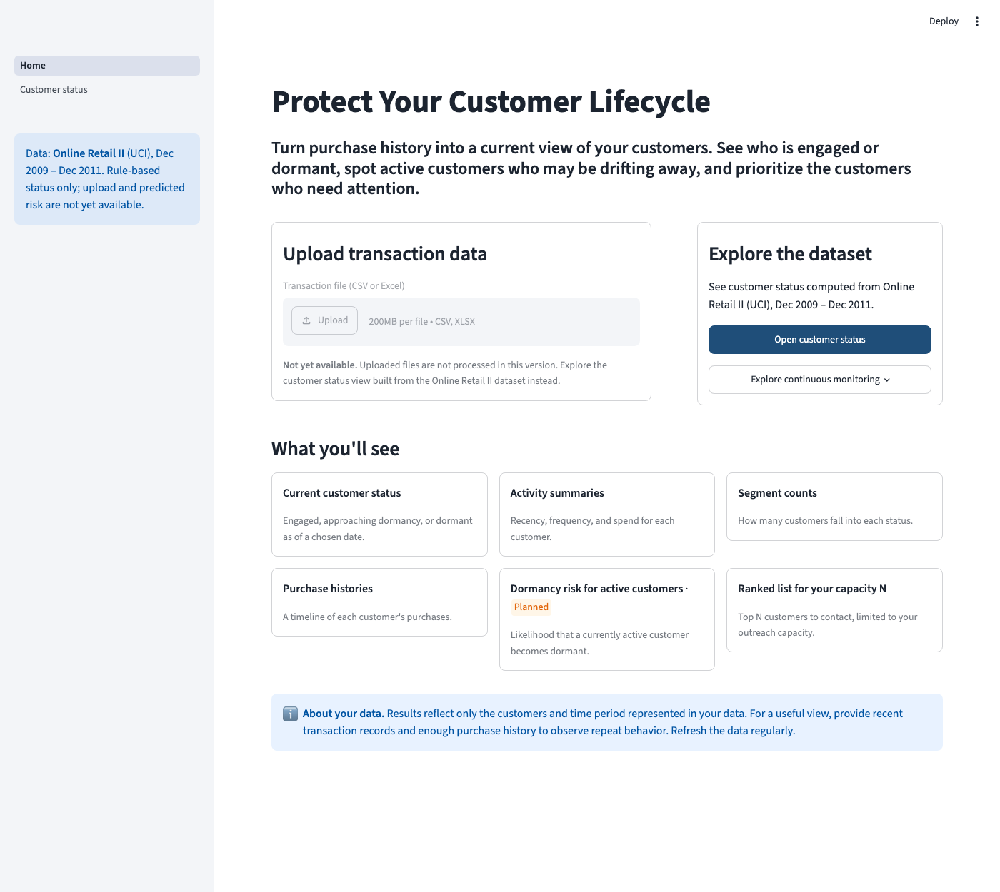
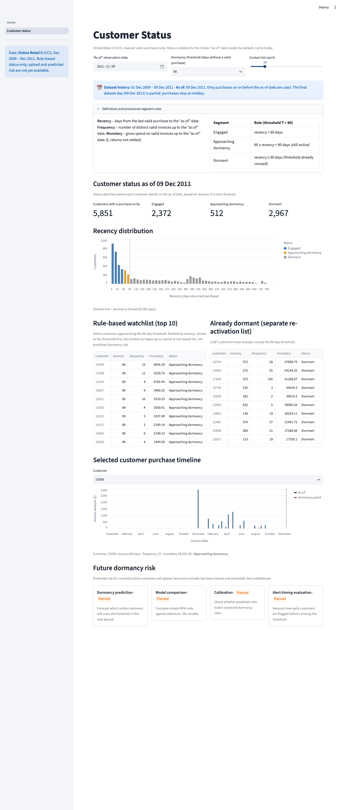

# Non-contractual Customer Dormancy Prediction

Final project for **AAI 627: Big Data Analytics for Engineering Design**,
part of the **M.S. in Data Science** at **Stevens Institute of Technology**.

A Streamlit website that turns retail purchase history into a current view of each customer:
who is **engaged**, who is **approaching dormancy**, and who is already **dormant**. Its goal is
to help a retention team decide whom to contact when it can reach only a limited number of
customers.

> **Current stage: Submission 5.** The website runs on the real **Online Retail II** data
> (cleaned, invoice level). Customer status and the watchlist are **rule-based**. No dormancy
> model has been trained yet. See [Project status](#project-status).

---

## Contents

1. [The problem](#the-problem)
2. [Key definitions](#key-definitions)
3. [Dataset](#dataset)
4. [Quick start](#quick-start)
5. [Website tour](#website-tour)
6. [Project status](#project-status)
7. [Repository structure](#repository-structure)

---

## The problem

In **non-contractual** retail, customers never formally cancel; they simply stop buying. The
business has no explicit "churn" event, so it has to infer engagement from purchase behavior.

**Business question:** *Which customers appear engaged, which are approaching dormancy, and which
are already dormant?*

**Who would use it:** retention, CRM, and marketing teams at a retailer.

**Why ranking matters:** outreach is limited. A team may only be able to email, call, or send
offers to **N** customers per cycle, so the site has to **rank** customers, not just label them.

- Customers who are **still active but approaching the threshold** are the main outreach
  candidates.
- Customers who are **already dormant** are listed separately, because winning them back is a
  different task.

---

## Key definitions

| Term | Meaning |
|---|---|
| **Valid purchase** | A non-cancelled invoice with an identified customer, positive quantities and prices, and at least one product line (see [Cleaning rules](#cleaning-rules)) |
| **Observation ("as of") date** | The date the analysis is run from. Only transactions on or before it are used |
| **Recency** | Days from the last valid purchase to the as-of date |
| **Frequency** | Number of distinct valid invoices up to the as-of date |
| **Monetary** | Gross spend (£) on valid invoices up to the as-of date; returns are not netted |
| **Dormant** | Recency of at least **90 days** (provisional threshold; 60 and 120 days will also be compared) |

**Dormancy is a state, not an exit.** A dormant customer may purchase again.

### Provisional segments (threshold T, default 90 days)

| Segment | Rule |
|---|---|
| Engaged | recency < T − 30 |
| Approaching dormancy | T − 30 ≤ recency < T (still active) |
| Dormant | recency ≥ T (threshold already crossed) |

**Current status vs. future risk:** *status* describes where a customer stands today, based on
recency. *Dormancy risk* would be a forecast of who becomes dormant next. Only status is shown
today. Risk is a planned feature.

---

## Dataset

**Online Retail II**, from the [UCI Machine Learning Repository](https://archive.ics.uci.edu/dataset/502/online+retail+ii).
It contains transactions from a UK-based online retailer.

Credit: Chen, D. (2012). *Online Retail II* [Dataset]. UCI Machine Learning Repository.
https://doi.org/10.24432/C5CG6D. Licensed under CC BY 4.0.

Verified by this project:

- Two sheets, `Year 2009-2010` and `Year 2010-2011`, with **1,067,371** rows in total
- Purchases from **1 Dec 2009 to 9 Dec 2011**. The last day is partial: purchases stop at 12:50
- Columns: `Invoice`, `StockCode`, `Description`, `Quantity`, `InvoiceDate`, `Price`,
  `Customer ID`, `Country`

The raw workbook is **not** committed. Download it to `data/online_retail_II.xlsx` (gitignored) and
run `python prepare_data.py` (needs `pip install openpyxl`) to rebuild the files in `processed/`.
The website reads only `processed/invoices.csv.gz`.

### Cleaning rules

Full counts are in [`processed/data_quality.md`](processed/data_quality.md).

| Rule | Rows removed |
|---|---:|
| Sheet 1 repeats 1–9 Dec 2010, which sheet 2 also holds; keep the sheet-2 copy (verified identical) | 22,523 |
| Missing `Customer ID` | 235,287 |
| Cancellation invoices (`C` prefix), stored separately in `processed/cancellations.csv.gz` | 18,446 |
| Quantity ≤ 0 or price ≤ 0 | 70 |
| `TEST*` and `ADJUST*` lines | 45 |
| Invoices with only postage, carriage, manual, bank-charge or discount lines | 350 |
| Purchases fully cancelled on the **same calendar day** (98 invoices, 77 customers) | 809 |

What remains is **36,496 invoices from 5,851 customers**, with a gross amount of **£16,945,042.16**.

- **Same-day full cancellations are removed.** A purchase is removed only when all of its lines
  (StockCode, quantity, price) are matched by cancellation lines from the same customer, on the
  same calendar day, issued at or after the purchase. This includes invoice 581483 (£168,469.60,
  customer 16446) and invoice 541431 (£77,183.60, customer 12346).
  - Because as-of dates are end-of-day, this never uses information that would be unavailable
    on the date being viewed.
  - **Ambiguous days are kept:** on 9 customer-days, each invoice matches on its own but the
    cancellations can't cover all of them together.
  - **Non-line-for-line cancellations are kept:** for example, invoice 556444 (£38,970) was
    reversed by a single manual `M` line, so it stays in the data.
- **Later cancellations are never applied.** A purchase cancelled on a later day stays in, so
  earlier as-of views are not affected by what happened afterwards.
- **Identical lines within a sheet are kept (11,602 rows).** They cannot be told apart from
  genuine repeat lines. Removing them would lower the gross total by £56,306.31.
- **Rounding:** each invoice amount is rounded to the penny once, and every total is the sum of
  those rounded amounts.

---

## Quick start

**Requirements:** Python 3.10 or newer.

```bash
# 1. Create and activate a virtual environment (first time only)
python3 -m venv .venv
source .venv/bin/activate        # Windows: .venv\Scripts\activate

# 2. Install dependencies (first time only)
pip install -r requirements.txt

# 3. Run the website
streamlit run app.py
```

Then open **http://localhost:8501**. Press `Ctrl+C` in the terminal to stop the server.

---

## Website tour

Current screenshots are in [`artifacts/submission5/`](artifacts/submission5/).

### 1. Main page (sidebar: "Home")

- **Headline and introduction:** "Protect Your Customer Lifecycle".
- **Upload transaction data:** shown but **disabled**, and labeled *Not yet available*.
- **Open customer status:** opens the results page.
- **Explore continuous monitoring:** informational only, **not implemented**.
- **What you'll see:** a preview of the features. Dormancy risk is marked **Planned**.

### 2. Customer status

Built from the Online Retail II data. The dataset's date range and the selected as-of date are
shown at the top, so the "current" status always means status on that date within the
dataset, not today.

| Control | Effect |
|---|---|
| As-of date | Uses only purchases on or before this date, then recalculates everything |
| Dormancy threshold (60 / 90 / 120 days) | Moves the segment boundaries and the earliest as-of date you can choose |
| Contact-list size N | Sets how many customers appear in the watchlist |
| Customer | Shows that customer's invoices up to the as-of date |

What the page shows:

- **Status counts:** engaged, approaching dormancy, dormant.
- **Recency distribution** with the threshold marked.
- **Rule-based watchlist:** the top N *active* customers approaching dormancy.
  - Ranked by recency, with customers closest to the threshold first.
  - Ties are broken by higher gross spend.
  - This is **not** predicted dormancy risk.
- **Already dormant:** a separate re-activation list.
- **Purchase timeline** for a selected customer.
- **Future dormancy risk:** prediction, model comparison, calibration and alert timing are all
  marked **Planned**.





The earlier mock-data version is in [`artifacts/submission4/`](artifacts/submission4/).

---

## Project status

| Area | Status |
|---|---|
| Problem definition and dormancy rule | ✅ Defined (threshold is provisional) |
| Data audit and cleaning of Online Retail II | ✅ Done (`prepare_data.py`, `processed/data_quality.md`) |
| RFM status, segment counts, timelines on real data | ✅ Works |
| Rule-based top-N watchlist | ✅ Works. A rule, not a prediction |
| File upload | ⏳ Shown as disabled. Not functional |
| Time-aware use of cancellations and returns | ⏳ Planned |
| Dormancy risk model, calibration, alert-timing evaluation | ⏳ Planned |
| Deployment to Streamlit Community Cloud | ⏳ Next step |
| Continuous monitoring integration | ❌ Out of scope for the course |

No model has been trained. The site does not report any accuracy, calibration, probability, or
outreach-effect values.

---

## Repository structure

```
.
├── app.py                  # Entry point: page navigation and sidebar notice
├── main_page.py            # Landing page
├── results_page.py         # Customer status dashboard (segments, watchlist, timeline)
├── prepare_data.py         # Rebuilds processed/ from the raw UCI workbook
├── processed/              # invoices.csv.gz (used by the site), cancellations.csv.gz, data_quality.md
├── requirements.txt        # streamlit, pandas, altair
├── .streamlit/config.toml  # Theme
├── artifacts/submission5/  # Current screenshots of both pages
├── artifacts/submission4/  # Screenshots of the earlier mockup
├── .gitignore              # Ignores data/ (raw workbook), virtual environments, caches, and secrets
└── README.md
```

---

*Course project for AAI 627 at Stevens Institute of Technology. Dataset source: Online Retail II,
UCI Machine Learning Repository.*
