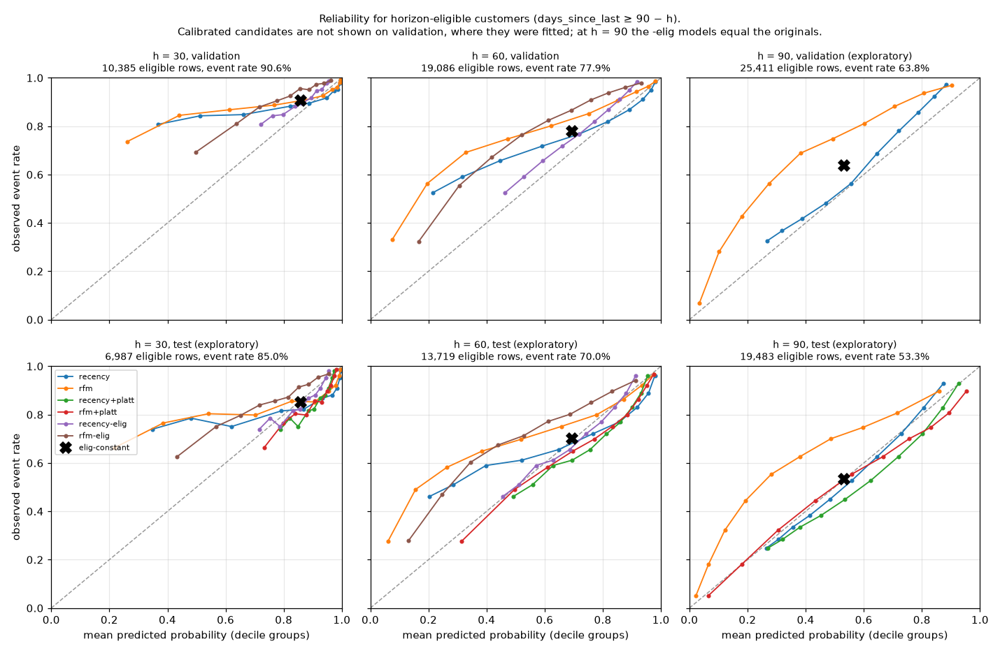

# Model evaluation: calibration, eligible customers and top-N targeting (Nov 19)

Generated by `evaluate_models.py` from `data/weekly_snapshots.csv.gz`. Do not edit by hand. Offline only: the website still shows the rule-based watchlist.

> **The test period is not an untouched holdout.** Its results for the selected recency model were inspected on Nov 12, and descriptive test event rates by recency band were viewed during this review. Every test number below is **exploratory**. The data end on 9 Dec 2011, and test already runs to the last complete day, so no later holdout exists in this dataset (Section 7).

## 1. Review of the current implementation

Confirmed, with checks run by this script on the real data:

- **Outcome, censoring and features.** An independent day-by-day recomputation of the features and all three labels for 1,000 randomly sampled snapshot rows found **0 mismatches**. Rebuilding the snapshots from invoices truncated at 2010-12-31 left every feature on every scoring date up to that day unchanged (**0 differences**), so features use no later purchases.
- **Eligibility.** At horizon h only `days_since_last` ≥ 90 − h can have an event; `eligible()` asserts this on every period.
- **Split.** Each role's labels are resolved before the next role's first scoring date (asserted for every horizon). Predictors come from an explicit allowlist; the scaling is fitted on training rows.
- **No leakage found.** The only future-derived columns (`crossing_date`, `y_*`) never reach `design()`.

Issues found and handled:

- *Wording error, fixed:* `baseline_results.md` called 2010-12-31 the "earliest" training cutoff that keeps 13 validation and 10 test scoring dates at h = 90. It is the **latest** such cutoff (2010-11-30 also qualifies). The split and every number are unchanged.
- *Feature drift, not leakage:* `tenure_days`, `frequency` and `monetary` are cumulative since 1 Dec 2009, so they grow with calendar time and a given value means something different in each period (Section 6, drift table). This makes `rfm` under-predict in later periods. Left unchanged here; the fix is proposed in Section 7.
- *Model misspecification, not a bug:* the Nov 12 models are fitted on all active rows. At h = 30 a single logistic curve in recency must be near 0 below 60 days and high above it, so it becomes very steep and is badly calibrated inside the eligible group. The Nov 12 selection used overall validation Brier, which mostly rewards that eligibility separation. Both points motivate Sections 3 and 6.

## 2. Evaluation setup

| Role | Period (scoring date s) | Used for |
|---|---|---|
| fit | train: s + h ≤ 2010-12-31 | coefficients and scaling |
| calibrate | validation: s > 2010-12-31, s + h ≤ 2011-06-30 | Platt calibrators (eligible rows) |
| compare | test: s > 2011-06-30, s + h ≤ 2011-12-08 | candidate comparison (exploratory) |
| final holdout | none available | – |

- **Populations.** *All active*: every snapshot row in the period. *Eligible*: rows with `days_since_last` ≥ 90 − h (at h = 90 this is everyone, so the two coincide).
- **Constant baselines** (fitted on train): `constant` = training event rate for every row; `elig-constant` = 0 for ineligible rows and the training **eligible-group** event rate for eligible rows. Within the eligible group, `elig-constant` is the reference constant.
- **Candidates** (fixed before scoring, see the script docstring): `recency` and `rfm` (Nov 12, fitted on all training rows; `recency` was selected); `+platt` = recalibrated on validation eligible rows, p′ = sigmoid(a + b·logit p), and 0 outside eligibility; `-elig` = the same specification refitted on eligible training rows only, and 0 outside eligibility. At h = 90 the `-elig` models equal the originals.
- **Calibration summary** (eligible rows): mean predicted vs observed rate, and the intercept and slope from a logistic regression of the outcome on logit(p). A slope of 1 and matching means indicate good calibration; slope < 1 means predictions are too extreme.
- **Uncertainty.** Brier differences have 95% intervals from a customer-level bootstrap (1000 resamples, all of a customer's weekly rows drawn together), because the same customer appears in many overlapping weekly snapshots.

## 3. Existing models: discrimination and Brier score

Nov 12 models as fitted then (coefficients reproduced exactly). `rfm` is scored on test here for the first time; this is exploratory and is not used to re-select the Nov 12 model.

| h | Period | Model | AUC all | Brier all | AUC eligible | Brier eligible | Mean p (elig) | Observed (elig) | Cal. slope (elig) |
|---|---|---|---:|---:|---:|---:|---:|---:|---:|
| 30 | validation | constant | 0.500 | 0.1835 | 0.500 | 0.6511 | 0.154 | 0.906 | – |
| 30 | validation | elig-constant | 0.984 | 0.0224 | 0.500 | 0.0879 | 0.857 | 0.906 | – |
| 30 | validation | recency | 0.990 | 0.0317 | 0.694 | 0.1176 | 0.815 | 0.906 | 0.36 |
| 30 | validation | rfm | 0.991 | 0.0337 | 0.734 | 0.1272 | 0.783 | 0.906 | 0.44 |
| 30 | test | constant | 0.500 | 0.1340 | 0.500 | 0.6129 | 0.154 | 0.850 | – |
| 30 | test | elig-constant | 0.983 | 0.0238 | 0.500 | 0.1272 | 0.857 | 0.850 | – |
| 30 | test | recency | 0.989 | 0.0294 | 0.674 | 0.1499 | 0.798 | 0.850 | 0.32 |
| 30 | test | rfm | 0.990 | 0.0312 | 0.706 | 0.1618 | 0.750 | 0.850 | 0.38 |
| 60 | validation | constant | 0.500 | 0.2610 | 0.500 | 0.3693 | 0.335 | 0.779 | – |
| 60 | validation | elig-constant | 0.883 | 0.1038 | 0.500 | 0.1794 | 0.694 | 0.779 | – |
| 60 | validation | recency | 0.941 | 0.1029 | 0.746 | 0.1742 | 0.688 | 0.779 | 0.59 |
| 60 | validation | rfm | 0.949 | 0.1051 | 0.809 | 0.1786 | 0.615 | 0.779 | 0.69 |
| 60 | test | constant | 0.500 | 0.2265 | 0.500 | 0.3433 | 0.335 | 0.700 | – |
| 60 | test | elig-constant | 0.886 | 0.1039 | 0.500 | 0.2101 | 0.694 | 0.700 | – |
| 60 | test | recency | 0.935 | 0.1033 | 0.714 | 0.2043 | 0.653 | 0.700 | 0.51 |
| 60 | test | rfm | 0.939 | 0.1042 | 0.768 | 0.2070 | 0.560 | 0.700 | 0.58 |
| 90 (exploratory) | validation | constant | 0.500 | 0.2421 | 0.500 | 0.2421 | 0.533 | 0.638 | – |
| 90 (exploratory) | validation | elig-constant | 0.500 | 0.2421 | 0.500 | 0.2421 | 0.533 | 0.638 | – |
| 90 (exploratory) | validation | recency | 0.782 | 0.1824 | 0.782 | 0.1824 | 0.588 | 0.638 | 1.19 |
| 90 (exploratory) | validation | rfm | 0.845 | 0.1930 | 0.845 | 0.1930 | 0.449 | 0.638 | 1.02 |
| 90 (exploratory) | test | constant | 0.500 | 0.2489 | 0.500 | 0.2489 | 0.533 | 0.533 | – |
| 90 (exploratory) | test | elig-constant | 0.500 | 0.2489 | 0.500 | 0.2489 | 0.533 | 0.533 | – |
| 90 (exploratory) | test | recency | 0.757 | 0.1994 | 0.757 | 0.1994 | 0.544 | 0.533 | 1.13 |
| 90 (exploratory) | test | rfm | 0.804 | 0.2113 | 0.804 | 0.2113 | 0.372 | 0.533 | 0.84 |

`elig-constant` has no AUC within the eligible group (one value). Its *overall* AUC shows how much ranking eligibility alone buys.

## 4. Calibration (reliability)

Decile groups of predicted probability among eligible customers. Points on the dashed diagonal are well calibrated; the black cross is the eligible-group constant. Quintile tables with counts follow.

h = 30: quintile tables (eligible rows)

**validation, recency**

| Group | n | Mean predicted | Observed |
|---:|---:|---:|---:|
| 1 | 2,077.0 | 0.440 | 0.825 |
| 2 | 2,077.0 | 0.741 | 0.865 |
| 3 | 2,077.0 | 0.918 | 0.906 |
| 4 | 2,077.0 | 0.980 | 0.949 |
| 5 | 2,077.0 | 0.995 | 0.982 |

**validation, rfm**

| Group | n | Mean predicted | Observed |
|---:|---:|---:|---:|
| 1 | 2,077.0 | 0.351 | 0.791 |
| 2 | 2,077.0 | 0.691 | 0.878 |
| 3 | 2,077.0 | 0.902 | 0.917 |
| 4 | 2,077.0 | 0.976 | 0.957 |
| 5 | 2,077.0 | 0.994 | 0.986 |

**validation, recency-elig**

| Group | n | Mean predicted | Observed |
|---:|---:|---:|---:|
| 1 | 2,077.0 | 0.741 | 0.825 |
| 2 | 2,077.0 | 0.819 | 0.865 |
| 3 | 2,077.0 | 0.879 | 0.906 |
| 4 | 2,077.0 | 0.922 | 0.949 |
| 5 | 2,077.0 | 0.951 | 0.982 |

**validation, rfm-elig**

| Group | n | Mean predicted | Observed |
|---:|---:|---:|---:|
| 1 | 2,077.0 | 0.566 | 0.751 |
| 2 | 2,077.0 | 0.746 | 0.892 |
| 3 | 2,077.0 | 0.839 | 0.940 |
| 4 | 2,077.0 | 0.899 | 0.962 |
| 5 | 2,077.0 | 0.950 | 0.983 |

**test, recency**

| Group | n | Mean predicted | Observed |
|---:|---:|---:|---:|
| 1 | 1,398.0 | 0.415 | 0.763 |
| 2 | 1,397.0 | 0.706 | 0.783 |
| 3 | 1,397.0 | 0.901 | 0.845 |
| 4 | 1,397.0 | 0.975 | 0.895 |
| 5 | 1,398.0 | 0.995 | 0.966 |

**test, rfm**

| Group | n | Mean predicted | Observed |
|---:|---:|---:|---:|
| 1 | 1,398.0 | 0.302 | 0.715 |
| 2 | 1,397.0 | 0.622 | 0.801 |
| 3 | 1,397.0 | 0.867 | 0.854 |
| 4 | 1,397.0 | 0.966 | 0.909 |
| 5 | 1,398.0 | 0.993 | 0.974 |

**test, recency+platt**

| Group | n | Mean predicted | Observed |
|---:|---:|---:|---:|
| 1 | 1,398.0 | 0.805 | 0.763 |
| 2 | 1,397.0 | 0.867 | 0.783 |
| 3 | 1,397.0 | 0.915 | 0.845 |
| 4 | 1,397.0 | 0.948 | 0.895 |
| 5 | 1,398.0 | 0.970 | 0.966 |

**test, rfm+platt**

| Group | n | Mean predicted | Observed |
|---:|---:|---:|---:|
| 1 | 1,398.0 | 0.766 | 0.715 |
| 2 | 1,397.0 | 0.858 | 0.801 |
| 3 | 1,397.0 | 0.918 | 0.854 |
| 4 | 1,397.0 | 0.956 | 0.909 |
| 5 | 1,398.0 | 0.978 | 0.974 |

**test, recency-elig**

| Group | n | Mean predicted | Observed |
|---:|---:|---:|---:|
| 1 | 1,398.0 | 0.734 | 0.763 |
| 2 | 1,397.0 | 0.809 | 0.783 |
| 3 | 1,397.0 | 0.871 | 0.845 |
| 4 | 1,397.0 | 0.917 | 0.895 |
| 5 | 1,398.0 | 0.949 | 0.966 |

**test, rfm-elig**

| Group | n | Mean predicted | Observed |
|---:|---:|---:|---:|
| 1 | 1,398.0 | 0.500 | 0.688 |
| 2 | 1,397.0 | 0.684 | 0.818 |
| 3 | 1,397.0 | 0.793 | 0.865 |
| 4 | 1,397.0 | 0.869 | 0.920 |
| 5 | 1,398.0 | 0.936 | 0.961 |

h = 60: quintile tables (eligible rows)

**validation, recency**

| Group | n | Mean predicted | Observed |
|---:|---:|---:|---:|
| 1 | 3,818.0 | 0.266 | 0.558 |
| 2 | 3,817.0 | 0.518 | 0.687 |
| 3 | 3,817.0 | 0.767 | 0.793 |
| 4 | 3,817.0 | 0.914 | 0.889 |
| 5 | 3,817.0 | 0.973 | 0.966 |

**validation, rfm**

| Group | n | Mean predicted | Observed |
|---:|---:|---:|---:|
| 1 | 3,818.0 | 0.136 | 0.448 |
| 2 | 3,817.0 | 0.401 | 0.719 |
| 3 | 3,817.0 | 0.687 | 0.827 |
| 4 | 3,817.0 | 0.882 | 0.924 |
| 5 | 3,817.0 | 0.969 | 0.975 |

**validation, recency-elig**

| Group | n | Mean predicted | Observed |
|---:|---:|---:|---:|
| 1 | 3,818.0 | 0.496 | 0.558 |
| 2 | 3,817.0 | 0.627 | 0.687 |
| 3 | 3,817.0 | 0.745 | 0.793 |
| 4 | 3,817.0 | 0.839 | 0.889 |
| 5 | 3,817.0 | 0.904 | 0.966 |

**validation, rfm-elig**

| Group | n | Mean predicted | Observed |
|---:|---:|---:|---:|
| 1 | 3,818.0 | 0.236 | 0.439 |
| 2 | 3,817.0 | 0.469 | 0.717 |
| 3 | 3,817.0 | 0.651 | 0.845 |
| 4 | 3,817.0 | 0.789 | 0.923 |
| 5 | 3,817.0 | 0.905 | 0.970 |

**test, recency**

| Group | n | Mean predicted | Observed |
|---:|---:|---:|---:|
| 1 | 2,744.0 | 0.245 | 0.486 |
| 2 | 2,744.0 | 0.459 | 0.601 |
| 3 | 2,743.0 | 0.706 | 0.688 |
| 4 | 2,744.0 | 0.887 | 0.799 |
| 5 | 2,744.0 | 0.968 | 0.926 |

**test, rfm**

| Group | n | Mean predicted | Observed |
|---:|---:|---:|---:|
| 1 | 2,744.0 | 0.108 | 0.383 |
| 2 | 2,744.0 | 0.324 | 0.616 |
| 3 | 2,743.0 | 0.588 | 0.725 |
| 4 | 2,744.0 | 0.825 | 0.832 |
| 5 | 2,744.0 | 0.955 | 0.945 |

**test, recency+platt**

| Group | n | Mean predicted | Observed |
|---:|---:|---:|---:|
| 1 | 2,744.0 | 0.526 | 0.486 |
| 2 | 2,744.0 | 0.662 | 0.601 |
| 3 | 2,743.0 | 0.784 | 0.688 |
| 4 | 2,744.0 | 0.880 | 0.799 |
| 5 | 2,744.0 | 0.943 | 0.926 |

**test, rfm+platt**

| Group | n | Mean predicted | Observed |
|---:|---:|---:|---:|
| 1 | 2,744.0 | 0.405 | 0.383 |
| 2 | 2,744.0 | 0.653 | 0.616 |
| 3 | 2,743.0 | 0.801 | 0.725 |
| 4 | 2,744.0 | 0.903 | 0.832 |
| 5 | 2,744.0 | 0.964 | 0.945 |

**test, recency-elig**

| Group | n | Mean predicted | Observed |
|---:|---:|---:|---:|
| 1 | 2,744.0 | 0.483 | 0.486 |
| 2 | 2,744.0 | 0.599 | 0.601 |
| 3 | 2,743.0 | 0.714 | 0.688 |
| 4 | 2,744.0 | 0.817 | 0.799 |
| 5 | 2,744.0 | 0.897 | 0.926 |

**test, rfm-elig**

| Group | n | Mean predicted | Observed |
|---:|---:|---:|---:|
| 1 | 2,744.0 | 0.189 | 0.374 |
| 2 | 2,744.0 | 0.392 | 0.638 |
| 3 | 2,743.0 | 0.569 | 0.742 |
| 4 | 2,744.0 | 0.724 | 0.826 |
| 5 | 2,744.0 | 0.873 | 0.919 |

h = 90 (exploratory): quintile tables (eligible rows)

**validation, recency**

| Group | n | Mean predicted | Observed |
|---:|---:|---:|---:|
| 1 | 5,083.0 | 0.293 | 0.347 |
| 2 | 5,082.0 | 0.429 | 0.450 |
| 3 | 5,082.0 | 0.600 | 0.624 |
| 4 | 5,082.0 | 0.754 | 0.819 |
| 5 | 5,082.0 | 0.864 | 0.948 |

**validation, rfm**

| Group | n | Mean predicted | Observed |
|---:|---:|---:|---:|
| 1 | 5,083.0 | 0.068 | 0.175 |
| 2 | 5,082.0 | 0.227 | 0.495 |
| 3 | 5,082.0 | 0.438 | 0.718 |
| 4 | 5,082.0 | 0.654 | 0.847 |
| 5 | 5,082.0 | 0.855 | 0.953 |

**validation, recency-elig**

| Group | n | Mean predicted | Observed |
|---:|---:|---:|---:|
| 1 | 5,083.0 | 0.293 | 0.347 |
| 2 | 5,082.0 | 0.429 | 0.450 |
| 3 | 5,082.0 | 0.600 | 0.624 |
| 4 | 5,082.0 | 0.754 | 0.819 |
| 5 | 5,082.0 | 0.864 | 0.948 |

**validation, rfm-elig**

| Group | n | Mean predicted | Observed |
|---:|---:|---:|---:|
| 1 | 5,083.0 | 0.068 | 0.175 |
| 2 | 5,082.0 | 0.227 | 0.495 |
| 3 | 5,082.0 | 0.438 | 0.718 |
| 4 | 5,082.0 | 0.654 | 0.847 |
| 5 | 5,082.0 | 0.855 | 0.953 |

**test, recency**

| Group | n | Mean predicted | Observed |
|---:|---:|---:|---:|
| 1 | 3,897.0 | 0.285 | 0.266 |
| 2 | 3,896.0 | 0.385 | 0.359 |
| 3 | 3,897.0 | 0.521 | 0.489 |
| 4 | 3,896.0 | 0.687 | 0.673 |
| 5 | 3,897.0 | 0.840 | 0.878 |

**test, rfm**

| Group | n | Mean predicted | Observed |
|---:|---:|---:|---:|
| 1 | 3,897.0 | 0.044 | 0.116 |
| 2 | 3,896.0 | 0.158 | 0.384 |
| 3 | 3,897.0 | 0.331 | 0.590 |
| 4 | 3,896.0 | 0.542 | 0.724 |
| 5 | 3,897.0 | 0.788 | 0.852 |

**test, recency+platt**

| Group | n | Mean predicted | Observed |
|---:|---:|---:|---:|
| 1 | 3,897.0 | 0.295 | 0.266 |
| 2 | 3,896.0 | 0.417 | 0.359 |
| 3 | 3,897.0 | 0.580 | 0.489 |
| 4 | 3,896.0 | 0.760 | 0.673 |
| 5 | 3,897.0 | 0.899 | 0.878 |

**test, rfm+platt**

| Group | n | Mean predicted | Observed |
|---:|---:|---:|---:|
| 1 | 3,897.0 | 0.123 | 0.116 |
| 2 | 3,896.0 | 0.369 | 0.384 |
| 3 | 3,897.0 | 0.612 | 0.590 |
| 4 | 3,896.0 | 0.793 | 0.724 |
| 5 | 3,897.0 | 0.923 | 0.852 |

**test, recency-elig**

| Group | n | Mean predicted | Observed |
|---:|---:|---:|---:|
| 1 | 3,897.0 | 0.285 | 0.266 |
| 2 | 3,896.0 | 0.385 | 0.359 |
| 3 | 3,897.0 | 0.521 | 0.489 |
| 4 | 3,896.0 | 0.687 | 0.673 |
| 5 | 3,897.0 | 0.840 | 0.878 |

**test, rfm-elig**

| Group | n | Mean predicted | Observed |
|---:|---:|---:|---:|
| 1 | 3,897.0 | 0.044 | 0.116 |
| 2 | 3,896.0 | 0.158 | 0.384 |
| 3 | 3,897.0 | 0.331 | 0.590 |
| 4 | 3,896.0 | 0.542 | 0.724 |
| 5 | 3,897.0 | 0.788 | 0.852 |

## 5. Outreach targeting: top N per week

At every weekly scoring date, eligible customers are ranked and the top N are "contacted", for N = 50, 100, 200 (median eligible customers per week: about 380 at h = 30, 1,000 at h = 60, 1,950 at h = 90).

- **Precision@N** = events among the contacted ÷ contacted. **Capture@N** = events among the contacted ÷ all events that week (every event is in the eligible group, so this is the share of that week's future dormancy caught).
- **Pooling:** contacts, captured events and events are summed over all weeks in the period, then divided. Weekly capture min–max is shown for spread. If a week has fewer than N eligible customers, all are contacted.
- **Ties:** customers tied on every ranking key at the cut-off share the remaining slots pro rata (the expected result of random tie-breaking), so no hidden ordering such as customer ID affects the numbers.
- **Rankers:** `random` (expected value: precision = the week's eligible event rate); `website rule` = the deployed watchlist order (recency descending, then higher spend); `recency` model (monotone in recency, so it is recency order with random tie-breaking); `rfm`; `rfm-elig`. Platt recalibration is monotone (slope > 0, asserted), so the `+platt` rankings equal their base models and are not repeated; `recency-elig` likewise equals `recency`.
- **This measures predictive targeting, not the effect of contacting anyone.** A high capture means the list contains customers who went on to become dormant, not that an intervention would have changed that; many of the highest-risk customers may be beyond reach. Estimating outreach impact needs a randomized or otherwise causal design.

**h = 30**

| Period | Ranker | P@50 | C@50 | P@100 | C@100 | P@200 | C@200 | C@100 weekly range |
|---|---|---:|---:|---:|---:|---:|---:|---|
| validation | random | 89.2% | 10.0% | 89.2% | 19.9% | 89.2% | 39.7% | 11.0%–55.2% |
| validation | website rule | 97.8% | 10.9% | 96.2% | 21.5% | 93.7% | 41.7% | 11.8%–57.0% |
| validation | recency | 98.0% | 10.9% | 96.3% | 21.5% | 93.9% | 41.7% | 11.7%–57.5% |
| validation | rfm | 98.9% | 11.0% | 97.2% | 21.7% | 94.5% | 42.0% | 11.5%–60.3% |
| validation | rfm-elig | 98.0% | 10.9% | 97.2% | 21.7% | 95.0% | 42.2% | 11.5%–60.9% |
| test (exploratory) | random | 84.8% | 12.8% | 84.8% | 25.7% | 84.8% | 51.4% | 22.2%–31.6% |
| test (exploratory) | website rule | 97.9% | 14.8% | 94.6% | 28.7% | 90.6% | 54.9% | 24.2%–36.4% |
| test (exploratory) | recency | 97.9% | 14.8% | 94.8% | 28.7% | 90.9% | 55.1% | 24.2%–36.9% |
| test (exploratory) | rfm | 97.7% | 14.8% | 95.9% | 29.1% | 92.1% | 55.8% | 24.5%–37.2% |
| test (exploratory) | rfm-elig | 96.7% | 14.6% | 94.8% | 28.7% | 92.4% | 56.0% | 24.4%–35.2% |

**h = 60**

| Period | Ranker | P@50 | C@50 | P@100 | C@100 | P@200 | C@200 | C@100 weekly range |
|---|---|---:|---:|---:|---:|---:|---:|---|
| validation | random | 76.3% | 4.4% | 76.3% | 8.7% | 76.3% | 17.5% | 5.4%–14.6% |
| validation | website rule | 97.6% | 5.6% | 96.5% | 11.0% | 94.2% | 21.6% | 6.5%–18.4% |
| validation | recency | 97.9% | 5.6% | 96.7% | 11.1% | 94.4% | 21.6% | 6.5%–18.6% |
| validation | rfm | 97.8% | 5.6% | 97.3% | 11.1% | 95.8% | 21.9% | 6.5%–19.5% |
| validation | rfm-elig | 96.4% | 5.5% | 96.5% | 11.0% | 95.7% | 21.9% | 6.5%–19.1% |
| test (exploratory) | random | 69.8% | 5.1% | 69.8% | 10.2% | 69.8% | 20.4% | 9.5%–11.4% |
| test (exploratory) | website rule | 98.3% | 7.2% | 95.3% | 13.9% | 91.8% | 26.8% | 12.2%–17.0% |
| test (exploratory) | recency | 98.3% | 7.2% | 95.4% | 13.9% | 92.0% | 26.8% | 12.2%–17.0% |
| test (exploratory) | rfm | 97.1% | 7.1% | 96.2% | 14.0% | 94.0% | 27.4% | 12.3%–16.8% |
| test (exploratory) | rfm-elig | 95.1% | 6.9% | 94.2% | 13.7% | 91.8% | 26.8% | 12.5%–16.7% |

**h = 90 (exploratory)**

| Period | Ranker | P@50 | C@50 | P@100 | C@100 | P@200 | C@200 | C@100 weekly range |
|---|---|---:|---:|---:|---:|---:|---:|---|
| validation | random | 62.7% | 2.5% | 62.7% | 5.0% | 62.7% | 10.1% | 4.0%–6.4% |
| validation | website rule | 97.1% | 3.9% | 96.5% | 7.7% | 94.3% | 15.1% | 5.5%–11.1% |
| validation | recency | 97.4% | 3.9% | 96.7% | 7.8% | 94.6% | 15.2% | 5.5%–11.1% |
| validation | rfm | 96.9% | 3.9% | 96.0% | 7.7% | 95.3% | 15.3% | 5.5%–10.9% |
| validation | rfm-elig | 96.9% | 3.9% | 96.0% | 7.7% | 95.3% | 15.3% | 5.5%–10.9% |
| test (exploratory) | random | 53.3% | 2.6% | 53.3% | 5.1% | 53.3% | 10.3% | 5.0%–5.3% |
| test (exploratory) | website rule | 98.0% | 4.7% | 95.8% | 9.2% | 92.5% | 17.8% | 8.5%–10.4% |
| test (exploratory) | recency | 98.1% | 4.7% | 95.8% | 9.2% | 92.8% | 17.9% | 8.5%–10.4% |
| test (exploratory) | rfm | 94.4% | 4.5% | 92.2% | 8.9% | 89.3% | 17.2% | 8.3%–9.7% |
| test (exploratory) | rfm-elig | 94.4% | 4.5% | 92.2% | 8.9% | 89.3% | 17.2% | 8.3%–9.7% |

## 6. Recalibration and model comparison (exploratory on test)

Eligible customers only. Δ Brier = candidate − reference, with a customer-bootstrap 95% interval; negative is better. Validation rows are shown only for candidates that were not calibrated on validation.

| h | Period | Model | AUC | Brier | Mean p | Observed | Cal. slope | Δ Brier vs recency [95% CI] | Δ Brier vs elig-constant [95% CI] |
|---|---|---|---:|---:|---:|---:|---:|---|---|
| 30 | validation | recency | 0.694 | 0.1176 | 0.815 | 0.906 | 0.36 | – | +0.0297 [+0.0268, +0.0327] |
| 30 | validation | rfm | 0.734 | 0.1272 | 0.783 | 0.906 | 0.44 | +0.0096 [+0.0075, +0.0115] | +0.0393 [+0.0347, +0.0433] |
| 30 | validation | recency-elig | 0.694 | 0.0846 | 0.862 | 0.906 | 1.07 | -0.0330 [-0.0352, -0.0309] | -0.0033 [-0.0041, -0.0025] |
| 30 | validation | rfm-elig | 0.765 | 0.0914 | 0.800 | 0.906 | 1.12 | -0.0262 [-0.0288, -0.0238] | +0.0035 [-0.0001, +0.0069] |
| 30 | test | recency | 0.674 | 0.1499 | 0.798 | 0.850 | 0.32 | – | +0.0226 [+0.0183, +0.0267] |
| 30 | test | rfm | 0.706 | 0.1618 | 0.750 | 0.850 | 0.38 | +0.0119 [+0.0088, +0.0149] | +0.0345 [+0.0279, +0.0405] |
| 30 | test | recency+platt | 0.674 | 0.1244 | 0.901 | 0.850 | 0.89 | -0.0254 [-0.0298, -0.0209] | -0.0028 [-0.0038, -0.0017] |
| 30 | test | rfm+platt | 0.706 | 0.1210 | 0.895 | 0.850 | 0.86 | -0.0289 [-0.0329, -0.0248] | -0.0063 [-0.0075, -0.0050] |
| 30 | test | recency-elig | 0.674 | 0.1217 | 0.856 | 0.850 | 0.96 | -0.0282 [-0.0312, -0.0250] | -0.0056 [-0.0068, -0.0044] |
| 30 | test | rfm-elig | 0.718 | 0.1290 | 0.756 | 0.850 | 0.88 | -0.0208 [-0.0249, -0.0166] | +0.0018 [-0.0042, +0.0074] |
| 60 | validation | recency | 0.746 | 0.1742 | 0.688 | 0.779 | 0.59 | – | -0.0052 [-0.0094, -0.0011] |
| 60 | validation | rfm | 0.809 | 0.1786 | 0.615 | 0.779 | 0.69 | +0.0043 [-0.0002, +0.0090] | -0.0008 [-0.0084, +0.0061] |
| 60 | validation | recency-elig | 0.746 | 0.1537 | 0.722 | 0.779 | 1.21 | -0.0206 [-0.0228, -0.0182] | -0.0257 [-0.0278, -0.0238] |
| 60 | validation | rfm-elig | 0.811 | 0.1648 | 0.610 | 0.779 | 1.08 | -0.0095 [-0.0146, -0.0044] | -0.0146 [-0.0216, -0.0080] |
| 60 | test | recency | 0.714 | 0.2043 | 0.653 | 0.700 | 0.51 | – | -0.0058 [-0.0111, -0.0008] |
| 60 | test | rfm | 0.768 | 0.2070 | 0.560 | 0.700 | 0.58 | +0.0027 [-0.0032, +0.0087] | -0.0031 [-0.0124, +0.0059] |
| 60 | test | recency+platt | 0.714 | 0.1903 | 0.759 | 0.700 | 0.86 | -0.0140 [-0.0184, -0.0095] | -0.0198 [-0.0225, -0.0170] |
| 60 | test | rfm+platt | 0.768 | 0.1719 | 0.745 | 0.700 | 0.85 | -0.0324 [-0.0375, -0.0279] | -0.0382 [-0.0426, -0.0340] |
| 60 | test | recency-elig | 0.714 | 0.1862 | 0.702 | 0.700 | 1.05 | -0.0180 [-0.0208, -0.0152] | -0.0238 [-0.0264, -0.0213] |
| 60 | test | rfm-elig | 0.757 | 0.1992 | 0.549 | 0.700 | 0.86 | -0.0051 [-0.0122, +0.0017] | -0.0109 [-0.0203, -0.0016] |
| 90 (exploratory) | validation | recency | 0.782 | 0.1824 | 0.588 | 0.638 | 1.19 | – | -0.0596 [-0.0635, -0.0559] |
| 90 (exploratory) | validation | rfm | 0.845 | 0.1930 | 0.449 | 0.638 | 1.02 | +0.0106 [+0.0033, +0.0179] | -0.0491 [-0.0567, -0.0417] |
| 90 (exploratory) | validation | recency-elig | 0.782 | 0.1824 | 0.588 | 0.638 | 1.19 | +0.0000 [+0.0000, +0.0000] | -0.0596 [-0.0635, -0.0559] |
| 90 (exploratory) | validation | rfm-elig | 0.845 | 0.1930 | 0.449 | 0.638 | 1.02 | +0.0106 [+0.0033, +0.0179] | -0.0491 [-0.0567, -0.0417] |
| 90 (exploratory) | test | recency | 0.757 | 0.1994 | 0.544 | 0.533 | 1.13 | – | -0.0496 [-0.0536, -0.0454] |
| 90 (exploratory) | test | rfm | 0.804 | 0.2113 | 0.372 | 0.533 | 0.84 | +0.0120 [+0.0033, +0.0209] | -0.0376 [-0.0471, -0.0283] |
| 90 (exploratory) | test | recency+platt | 0.757 | 0.2028 | 0.590 | 0.533 | 0.95 | +0.0035 [+0.0018, +0.0050] | -0.0461 [-0.0507, -0.0414] |
| 90 (exploratory) | test | rfm+platt | 0.804 | 0.1806 | 0.564 | 0.533 | 0.83 | -0.0188 [-0.0254, -0.0119] | -0.0683 [-0.0763, -0.0607] |
| 90 (exploratory) | test | recency-elig | 0.757 | 0.1994 | 0.544 | 0.533 | 1.13 | +0.0000 [+0.0000, +0.0000] | -0.0496 [-0.0536, -0.0454] |
| 90 (exploratory) | test | rfm-elig | 0.804 | 0.2113 | 0.372 | 0.533 | 0.84 | +0.0120 [+0.0033, +0.0209] | -0.0376 [-0.0471, -0.0283] |

Decision rule (fixed in advance): a candidate improves on `recency` if its test Δ Brier interval lies entirely below zero. Candidates meeting it, per horizon: h = 30: recency+platt, rfm+platt, recency-elig, rfm-elig; h = 60: recency+platt, rfm+platt, recency-elig; h = 90: rfm+platt. Because test was already inspected, this is a provisional ranking, not a confirmed selection.

Fitted calibrators (validation eligible rows), p′ = sigmoid(a + b·logit p):

| h | Base model | a | b |
|---|---|---:|---:|
| 30 | recency | 1.552 | 0.362 |
| 30 | rfm | 1.586 | 0.437 |
| 60 | recency | 0.774 | 0.588 |
| 60 | rfm | 1.158 | 0.686 |
| 90 (exploratory) | recency | 0.224 | 1.193 |
| 90 (exploratory) | rfm | 1.191 | 1.018 |

Feature drift (eligible rows, h = 60): medians of the cumulative features and the event rate by frequency band (share of rows in brackets).

| Period | Median tenure (days) | Median frequency | Median monetary (£) | Event rate | 1 invoice | 2–3 | 4–10 | >10 |
|---|---:|---:|---:|---:|---:|---:|---:|---:|
| train | 97 | 2 | 583 | 69.4% | 82.9% (40.3%) | 68.7% (37.3%) | 47.7% (21.0%) | 25.9% (1.3%) |
| validation | 301 | 4 | 1,142 | 77.9% | 91.6% (18.9%) | 89.4% (27.0%) | 73.6% (43.2%) | 42.3% (10.9%) |
| test | 456 | 5 | 1,462 | 70.0% | 81.1% (12.8%) | 81.8% (24.3%) | 69.7% (44.6%) | 47.1% (18.3%) |

## 7. Findings, limitations and next step

Findings (all test numbers exploratory):

1. **Eligibility explains most of the headline performance.** The two-level `elig-constant` (0 if the customer cannot
   reach 90 days within h, else the training eligible rate) has an overall AUC of 0.98 at h = 30 and 0.88–0.89 at h = 60, and
   at h = 30 a *lower* overall Brier score than the selected recency model (test 0.0238 vs 0.0294; validation 0.0224 vs
   0.0317). At h = 60 the two are about equal. Overall metrics should not be used to judge these models.
2. **Inside the eligible group, the Nov 12 models are miscalibrated at h = 30 and h = 60.** Calibration slopes are
   0.32–0.69 (predictions far too spread out) and mean predictions sit below the observed rate. This is why `recency`
   loses to the eligible constant on Brier at h = 30 (test +0.023, interval excludes 0). At h = 90, where eligibility is
   everyone, `recency` is reasonably calibrated (test mean 0.544 vs 0.533 observed, slope 1.13) and beats the constant
   (−0.050).
3. **RFM ranks better but is badly calibrated, because its cumulative features drift.** Within the eligible group, `rfm`
   has a higher AUC than `recency` at every horizon on both validation and test (+0.03 to +0.06). But its mean prediction
   is well below the observed rate in both later periods (h = 90 test: 0.372 vs 0.533), so its Brier score is worse than
   `recency` at every horizon (clearly at h = 30 and h = 90; within noise at h = 60). The drift table shows why: tenure, frequency and spend accumulate from the start of the data, and
   the same invoice count carries a higher dormancy rate later on.
4. **Two fixes, with different effects.**
   - *Refitting on eligible rows* (`-elig`) fixes the slope (0.86–1.21). `recency-elig` beats both `recency` and the
     eligible constant on test at h = 30 and h = 60, and on validation too, which was not used to fit it. It does not fix
     `rfm`'s level, because drift is not a slope problem (`rfm-elig` test mean 0.756 vs 0.850 at h = 30, 0.549 vs 0.700 at
     h = 60).
   - *Platt recalibration on validation* helps `rfm` at every horizon. `rfm+platt` has the lowest eligible-group test
     Brier score at all three horizons (0.1210, 0.1719, 0.1806), with `recency-elig` within 0.001 at h = 30. Validation is
     later than train, so its calibrator partly absorbs the drift. But it overshoots the level (test mean 0.895 vs 0.850,
     0.745 vs 0.700, 0.564 vs 0.533) because validation (Jan–Jun 2011) had more dormancy than test. For `recency`, Platt
     helps at h = 30 and h = 60 and slightly *hurts* at h = 90 (+0.0035, interval excludes 0). Recalibration is not
     automatically an improvement.
5. **No model meaningfully improves top-N targeting over the deployed rule.** Ranking eligible customers by recency (the
   website order) already gives 91–98% precision for N ≤ 200 at every horizon, against 53–89% for random selection. The
   best model adds at most about 2 points (N = 200 at h = 30 and h = 60; at N = 50 the models are sometimes below the
   rule), and at h = 90 `rfm` (and so `rfm+platt`, which
   ranks identically) is *worse* than the rule (test P@200 89.3% vs 92.5%). RFM's AUC gain comes from the middle of the
   ranking, not from the very top, where customers about to reach 90 days are near-certain events. These top-N lists
   are mostly customers already days from the threshold; whether contacting them changes anything is a causal question this
   evaluation cannot answer.

Provisional reading: for **probabilities**, a model fitted on eligible customers and calibrated on a period like the one it
will be used in is clearly better than the Nov 12 models. `rfm+platt` and `recency-elig` lead. For **ranking a small
contact list**, the rule-based order is as good as any model here. Neither conclusion has an untouched confirmation.

Limitations:

- **The test period had already been inspected**, and the candidates were compared on it. The best test candidate's score
  is optimistic: six candidates were compared and the best was picked after the fact.
- **Repeated weekly snapshots.** A customer contributes many overlapping rows. The customer bootstrap intervals cover
  Brier differences; AUC and top-N values have no intervals and the weeks are not independent, so top-N differences of
  1–2 points should not be read as real.
- **h = 90 is exploratory**: 10 test scoring dates (Jul–Sep 2011) with heavily overlapping windows, and a validation period
  whose event rate (64%) differs from train and test (53%).
- **Seasonality and drift.** One year of training covers each season once. Calibrators inherit the season they were
  fitted in. Cumulative features drift (Section 6).
- **Unchanged carry-overs:** tenure is left-truncated at 1 Dec 2009; later-day cancellations still count as purchases.
- **Capture is predictive, not causal** (Section 5).

Holdout: the data end on 9 Dec 2011 and test already reaches the last complete day, so **no genuinely later holdout can be
built from this dataset**. The only clean confirmation would be prospective: freeze one model and calibrator, score new
weeks as they arrive, and evaluate after the h-day outcomes mature, without changing anything in between.

Recommended next step: replace the cumulative features with window-stable ones (for example invoices and spend in the last
365 days, and tenure capped at 365 days). Fit on eligible training rows and compare the uncalibrated `-elig` variants on
**validation**, which they do not touch. Then freeze the choice before looking at test again. Keep the website on the rule-based
watchlist until then.
